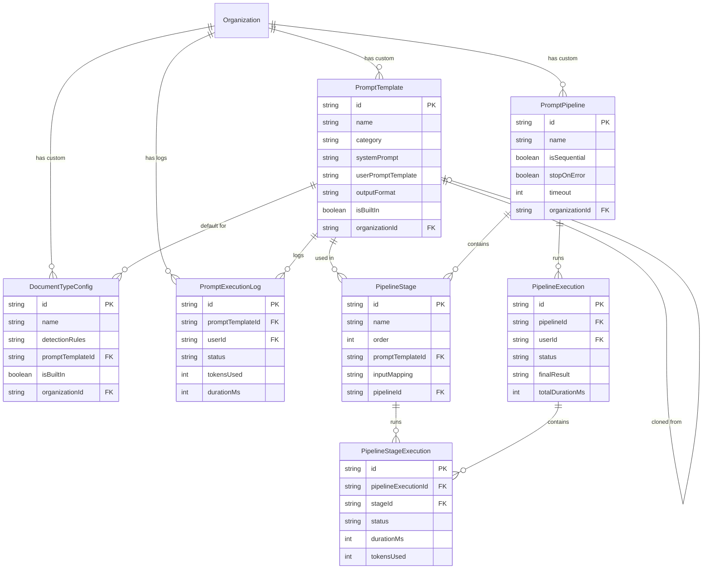

# Data Models

This document describes the database schema and entity relationships for ThreatForge.

## Overview

The database schema is managed by Prisma ORM and supports both PostgreSQL (cloud deployments) and SQLite (desktop/development).

## Entity Relationship Diagram

```
┌─────────────────┐     ┌─────────────────┐     ┌─────────────────┐
│      User       │────<│   Membership    │>────│  Organization   │
└─────────────────┘     └─────────────────┘     └─────────────────┘
        │                                               │
        │                                               │
        ▼                                               ▼
┌─────────────────┐                            ┌─────────────────┐
│    ApiToken     │                            │    Project      │
└─────────────────┘                            └─────────────────┘
        │                                               │
        │                                               │
        ▼                                               ▼
┌─────────────────┐                            ┌─────────────────┐
│  UserSession    │                            │  ThreatModel    │
└─────────────────┘                            └─────────────────┘
                                                       │
                    ┌──────────────────────────────────┼──────────────────────────────────┐
                    │                                  │                                  │
                    ▼                                  ▼                                  ▼
            ┌─────────────────┐              ┌─────────────────┐              ┌─────────────────┐
            │    Component    │              │   Connection    │              │    Boundary     │
            └─────────────────┘              └─────────────────┘              └─────────────────┘
                    │
                    ▼
            ┌─────────────────┐
            │     Threat      │
            └─────────────────┘
                    │
                    ▼
            ┌─────────────────┐
            │   Mitigation    │
            └─────────────────┘
```

---

## Core Entities

### User

The central user account entity.

| Field | Type | Description |
|-------|------|-------------|
| id | String | Primary key (CUID) |
| email | String | Unique email address |
| username | String? | Optional unique username |
| emailVerified | DateTime? | Email verification timestamp |
| passwordHash | String? | Bcrypt password hash |
| name | String | Display name |
| image | String? | Profile image URL |
| avatarUrl | String? | Avatar URL |
| status | UserStatus | Account status |
| failedLoginAttempts | Int | Failed login counter |
| lockedUntil | DateTime? | Account lock expiry |
| lastLoginIp | String? | Last login IP address |
| isSuperAdmin | Boolean | Platform administrator flag |
| defaultOrganizationId | String? | Preferred organization |
| twoFactorEnabled | Boolean | 2FA enabled flag |
| twoFactorSecret | String? | Encrypted TOTP secret |
| twoFactorBackupCodes | String? | Encrypted backup codes |
| preferences | String? | JSON user preferences |
| createdAt | DateTime | Created timestamp |
| updatedAt | DateTime | Updated timestamp |
| lastLoginAt | DateTime? | Last login timestamp |

**UserStatus Enum:**
- `PENDING_VERIFICATION` - Email not verified
- `ACTIVE` - Normal active user
- `SUSPENDED` - Manually suspended
- `LOCKED` - Auto-locked (failed logins)
- `PENDING_DELETION` - GDPR deletion pending
- `DELETED` - Soft-deleted

### Organization

Multi-tenant workspace container.

| Field | Type | Description |
|-------|------|-------------|
| id | String | Primary key |
| name | String | Organization name |
| slug | String | URL-friendly identifier |
| description | String? | Description |
| logoUrl | String? | Logo image URL |
| type | OrgType | Organization type |
| isPersonal | Boolean | Personal workspace flag |
| ownerId | String? | Owner user ID |
| allowGuestAccess | Boolean | Guest access enabled |
| guestDefaultRole | GuestRole | Default guest role |
| allowGuestExport | Boolean | Guests can export |
| maxMembers | Int? | Member quota |
| maxProjects | Int? | Project quota |
| maxModelsPerProject | Int? | Models per project quota |
| settings | String? | JSON settings |
| aiSettings | String? | JSON AI configuration |
| ssoEnabled | Boolean | SSO enabled |
| ssoProvider | SSOProvider? | SSO provider type |
| ssoConfig | String? | Encrypted SSO config |
| ssoDomain | String? | Domain for SSO routing |
| ssoEnforced | Boolean | Require SSO for all |
| deletedAt | DateTime? | Soft delete timestamp |
| createdAt | DateTime | Created timestamp |
| updatedAt | DateTime | Updated timestamp |

**OrgType Enum:**
- `PERSONAL` - Single-user workspace
- `TEAM` - Team workspace
- `ENTERPRISE` - Enterprise features

**SSOProvider Enum:**
- `SAML` - SAML 2.0
- `OIDC` - OpenID Connect
- `AZURE_AD` - Microsoft Entra ID
- `GOOGLE` - Google Workspace
- `OKTA` - Okta

### Membership

Links users to organizations with roles.

| Field | Type | Description |
|-------|------|-------------|
| id | String | Primary key |
| role | MemberRole | Member role |
| status | MemberStatus | Membership status |
| userId | String | User foreign key |
| organizationId | String | Organization foreign key |
| customRoleId | String? | Custom role override |
| invitedById | String? | Inviter user ID |
| invitedAt | DateTime? | Invitation timestamp |
| invitationToken | String? | Unique invitation token |
| invitationExpiresAt | DateTime? | Token expiry |
| acceptedAt | DateTime? | Acceptance timestamp |
| suspendedBy | String? | Suspender user ID |
| suspendedAt | DateTime? | Suspension timestamp |
| suspensionReason | String? | Suspension reason |
| createdAt | DateTime | Created timestamp |
| updatedAt | DateTime | Updated timestamp |

**MemberRole Enum:**
- `OWNER` - Full control
- `ADMIN` - Administrative access
- `EDITOR` - Create/edit access
- `VIEWER` - Read-only access

**MemberStatus Enum:**
- `PENDING` - Invitation sent
- `ACTIVE` - Active member
- `SUSPENDED` - Suspended

### Project

Groups threat models for organization.

| Field | Type | Description |
|-------|------|-------------|
| id | String | Primary key |
| name | String | Project name |
| description | String? | Description |
| status | ProjectStatus | Project status |
| organizationId | String | Organization foreign key |
| createdById | String | Creator user ID |
| createdAt | DateTime | Created timestamp |
| updatedAt | DateTime | Updated timestamp |

**ProjectStatus Enum:**
- `ACTIVE`
- `ARCHIVED`

### ThreatModel

The main threat model entity containing canvas state.

| Field | Type | Description |
|-------|------|-------------|
| id | String | Primary key |
| name | String | Model name |
| version | Int | Version counter |
| status | ModelStatus | Lifecycle status |
| tags | String | JSON array of tags |
| canvasState | String | JSON React Flow state |
| collaborationState | String? | Base64 Yjs state |
| projectId | String | Project foreign key |
| createdById | String | Creator user ID |
| createdAt | DateTime | Created timestamp |
| updatedAt | DateTime | Updated timestamp |

**ModelStatus Enum:**
- `DRAFT` - Work in progress
- `IN_REVIEW` - Under review
- `PUBLISHED` - Approved/finalized
- `ARCHIVED` - No longer active

**Canvas State Structure:**
```json
{
  "nodes": [
    {
      "id": "node-1",
      "type": "componentNode",
      "position": { "x": 100, "y": 200 },
      "data": {
        "label": "API Gateway",
        "componentType": "API_GATEWAY",
        "trustLevel": "MEDIUM",
        "interfaces": [...]
      }
    }
  ],
  "edges": [
    {
      "id": "edge-1",
      "source": "node-1",
      "target": "node-2",
      "data": {
        "label": "REST API",
        "protocol": "HTTPS",
        "encrypted": true
      }
    }
  ],
  "viewport": { "x": 0, "y": 0, "zoom": 1 }
}
```

---

## Canvas Entities

These tables are populated on-demand from the `canvasState` JSON for querying purposes.

### Component

Represents a node in the threat model canvas.

| Field | Type | Description |
|-------|------|-------------|
| id | String | Primary key |
| nodeId | String | React Flow node ID |
| type | ComponentType | Component type |
| name | String | Display name |
| description | String? | Description |
| trustLevel | TrustLevel | Trust level |
| properties | String | JSON type-specific properties |
| positionX | Float | X coordinate |
| positionY | Float | Y coordinate |
| threatModelId | String | Threat model foreign key |
| boundaryId | String? | Parent boundary |
| createdAt | DateTime | Created timestamp |
| updatedAt | DateTime | Updated timestamp |

**ComponentType Enum (partial):**
- Actors: `EXTERNAL_USER`, `INTERNAL_USER`, `EXTERNAL_SYSTEM`
- Processing: `SERVICE`, `API`, `FUNCTION`, `PROCESS`
- Storage: `DATABASE`, `FILE_STORAGE`, `CACHE`, `QUEUE`
- Network: `LOAD_BALANCER`, `FIREWALL`, `API_GATEWAY`

**TrustLevel Enum:**
- `HIGH`
- `MEDIUM`
- `LOW`
- `UNTRUSTED`

### ComponentInterface

Network endpoint on a component.

| Field | Type | Description |
|-------|------|-------------|
| id | String | Primary key |
| interfaceId | String | Frontend handle ID |
| name | String | Interface name |
| direction | InterfaceDirection | Traffic direction |
| position | InterfacePosition | Visual position |
| port | Int? | Port number |
| protocol | Protocol? | Protocol type |
| authentication | AuthMethod? | Auth method |
| encrypted | Boolean | TLS enabled |
| dataClassifications | String | JSON array |
| externallyAccessible | Boolean | Public facing |
| componentId | String | Component foreign key |
| createdAt | DateTime | Created timestamp |
| updatedAt | DateTime | Updated timestamp |

**InterfaceDirection Enum:**
- `INGRESS`
- `EGRESS`
- `BIDIRECTIONAL`

**InterfacePosition Enum:**
- `LEFT`, `RIGHT`, `TOP`, `BOTTOM`

### Connection

Represents an edge (data flow) between components.

| Field | Type | Description |
|-------|------|-------------|
| id | String | Primary key |
| edgeId | String | React Flow edge ID |
| label | String? | Connection label |
| protocol | Protocol? | Protocol type |
| authentication | AuthMethod? | Auth method |
| dataTypes | String | JSON array of data types |
| dataClassifications | String | JSON array |
| encrypted | Boolean | Encrypted connection |
| description | String? | Description |
| threatModelId | String | Threat model foreign key |
| sourceComponentId | String | Source component |
| targetComponentId | String | Target component |
| sourceInterfaceId | String? | Source interface |
| targetInterfaceId | String? | Target interface |
| crossesBoundary | Boolean | Crosses trust boundary |
| createdAt | DateTime | Created timestamp |
| updatedAt | DateTime | Updated timestamp |

**Protocol Enum:**
- `HTTP`, `HTTPS`, `GRPC`, `WEBSOCKET`
- `TCP`, `UDP`, `AMQP`, `MQTT`, `KAFKA`
- `POSTGRESQL`, `MYSQL`, `MONGODB`, `REDIS`
- `SSH`, `SFTP`, `CUSTOM`

**AuthMethod Enum:**
- `NONE`, `API_KEY`, `JWT`, `OAUTH2`
- `MTLS`, `BASIC`, `SAML`, `CUSTOM`

### Boundary

Trust boundary (group node) containing components.

| Field | Type | Description |
|-------|------|-------------|
| id | String | Primary key |
| nodeId | String | React Flow group node ID |
| name | String | Boundary name |
| trustLevel | TrustLevel | Trust level |
| description | String? | Description |
| positionX | Float | X coordinate |
| positionY | Float | Y coordinate |
| width | Float | Width |
| height | Float | Height |
| threatModelId | String | Threat model foreign key |
| createdAt | DateTime | Created timestamp |
| updatedAt | DateTime | Updated timestamp |

---

## Threat Entities

### Threat

Security threat identified in the model.

| Field | Type | Description |
|-------|------|-------------|
| id | String | Primary key |
| name | String | Threat name |
| description | String? | Description |
| strideCategories | String | JSON array of STRIDE categories |
| severity | Severity | Severity level |
| status | ThreatStatus | Threat status |
| category | String? | Custom category |
| complianceControls | String | JSON compliance mappings |
| cweIds | String | JSON array of CWE IDs |
| owaspIds | String | JSON array of OWASP IDs |
| templateId | String? | Source template |
| threatModelId | String | Threat model foreign key |
| componentNodeId | String? | Linked component node ID |
| connectionEdgeId | String? | Linked connection edge ID |
| source | ThreatSource | MANUAL / AI_SUGGESTED / AI_ACCEPTED / AI_MODIFIED |
| reviewStatus | ReviewStatus | PENDING / ACCEPTED / REJECTED / MODIFIED |
| manuallyEdited | Boolean | True once a human has edited (AI skips on re-run) |
| analysisSessionId | String? | aiJob.id that created this row — used for failure-cleanup (ADR-006 T1.2) |
| normalizedName | String? | Paraphrase-normalized key (ADR-006 T3.1) used by the dedup unique index |
| createdById | String | Creator user ID |
| createdAt | DateTime | Created timestamp |
| updatedAt | DateTime | Updated timestamp |

**Dedup unique index (ADR-006 T1.1):**

```sql
UNIQUE (threatModelId,
        COALESCE(componentNodeId, connectionEdgeId, '__compound__'),
        normalizedName)
WHERE normalizedName IS NOT NULL;
```

Physically prevents duplicate threats on the same
`(model, attach-target, normalized-name)` tuple. The `COALESCE` sentinel
closes Postgres's "NULLs are distinct" gap — compound threats
(`componentNodeId IS NULL AND connectionEdgeId IS NULL`) all share the
`'__compound__'` key so they don't bypass the constraint. Maintained via
raw SQL migration (`server/prisma/migrations/add-threat-dedup.sql`) since
functional indexes aren't expressible in Prisma schema.

**StrideCategory Enum:**
- `SPOOFING`
- `TAMPERING`
- `REPUDIATION`
- `INFORMATION_DISCLOSURE`
- `DENIAL_OF_SERVICE`
- `ELEVATION_OF_PRIVILEGE`

**Severity Enum:**
- `CRITICAL`, `HIGH`, `MEDIUM`, `LOW`, `INFO`

**ThreatStatus Enum:**
- `OPEN` - Needs addressing
- `MITIGATED` - Has mitigations
- `ACCEPTED` - Risk accepted
- `NOT_APPLICABLE` - Not relevant

### Mitigation

Action to address a threat.

| Field | Type | Description |
|-------|------|-------------|
| id | String | Primary key |
| description | String | Mitigation description |
| status | MitigationStatus | Status |
| priority | Priority | Priority level |
| strategy | MitigationStrategy | Strategy type |
| notes | String? | Additional notes |
| dueDate | DateTime? | Target date |
| threatId | String | Threat foreign key |
| assigneeId | String? | Assigned user |
| createdById | String | Creator user ID |
| createdAt | DateTime | Created timestamp |
| updatedAt | DateTime | Updated timestamp |

**MitigationStatus Enum:**
- `PLANNED`
- `IN_PROGRESS`
- `COMPLETED`
- `VERIFIED`

**Priority Enum:**
- `CRITICAL`, `HIGH`, `MEDIUM`, `LOW`

**MitigationStrategy Enum:**
- `PREVENTION` - Stop threat from occurring
- `DETECTION` - Detect if threat occurs
- `RESPONSE` - Respond to detected threat
- `RECOVERY` - Recover from impact
- `DETERRENCE` - Discourage threat actor

### ThreatRiskScore

Risk score calculation for a threat.

| Field | Type | Description |
|-------|------|-------------|
| id | String | Primary key |
| threatId | String | Threat foreign key |
| frameworkId | String | Risk framework foreign key |
| factors | String | JSON input factors |
| score | Float | Calculated score (0-10) |
| rating | String | Text rating |
| calculatedAt | DateTime | Calculation timestamp |
| calculatedById | String? | Calculator user ID |

---

## Library Entities

### ThreatLibrary

Collection of threat templates.

| Field | Type | Description |
|-------|------|-------------|
| id | String | Primary key |
| name | String | Library name |
| description | String? | Description |
| isDefault | Boolean | System library |
| isPublic | Boolean | Publicly visible |
| organizationId | String? | Owner organization |
| createdAt | DateTime | Created timestamp |
| updatedAt | DateTime | Updated timestamp |

### ThreatTemplate

Reusable threat definition.

| Field | Type | Description |
|-------|------|-------------|
| id | String | Primary key |
| name | String | Template name |
| description | String | Description |
| strideCategory | StrideCategory | Primary STRIDE category |
| defaultSeverity | Severity | Default severity |
| applicableComponentTypes | String | JSON array of types |
| suggestedMitigations | String | JSON array of strings |
| complianceControls | String | JSON compliance mappings |
| cweIds | String | JSON array of CWE IDs |
| owaspIds | String | JSON array of OWASP IDs |
| libraryId | String | Library foreign key |
| createdAt | DateTime | Created timestamp |
| updatedAt | DateTime | Updated timestamp |

### MitigationLibrary

Collection of mitigation templates.

| Field | Type | Description |
|-------|------|-------------|
| id | String | Primary key |
| name | String | Library name |
| description | String? | Description |
| isDefault | Boolean | System library |
| isPublic | Boolean | Publicly visible |
| organizationId | String? | Owner organization |
| createdById | String? | Creator user ID |
| createdAt | DateTime | Created timestamp |
| updatedAt | DateTime | Updated timestamp |

### MitigationTemplate

Reusable mitigation definition.

| Field | Type | Description |
|-------|------|-------------|
| id | String | Primary key |
| name | String | Template name |
| description | String | Description |
| strategy | MitigationStrategy | Strategy type |
| effort | EffortLevel | Implementation effort |
| effectiveness | EffectivenessLevel | Effectiveness rating |
| applicableThreatTypes | String | JSON array of STRIDE |
| complianceControls | String | JSON compliance mappings |
| implementationSteps | String | JSON array of steps |
| prerequisites | String | JSON array |
| relatedTemplateIds | String | JSON array of IDs |
| tags | String | JSON array of tags |
| usageCount | Int | Usage counter |
| libraryId | String | Library foreign key |
| createdById | String? | Creator user ID |
| createdAt | DateTime | Created timestamp |
| updatedAt | DateTime | Updated timestamp |

**EffortLevel Enum:**
- `TRIVIAL`, `LOW`, `MEDIUM`, `HIGH`, `VERY_HIGH`

**EffectivenessLevel Enum:**
- `LOW`, `MEDIUM`, `HIGH`, `VERY_HIGH`

### ComponentTemplateLibrary

Collection of component templates.

| Field | Type | Description |
|-------|------|-------------|
| id | String | Primary key |
| name | String | Library name |
| description | String? | Description |
| isDefault | Boolean | System library |
| isPublic | Boolean | Publicly visible |
| organizationId | String? | Owner organization |
| createdAt | DateTime | Created timestamp |
| updatedAt | DateTime | Updated timestamp |

### ComponentTemplate

Reusable component configuration.

| Field | Type | Description |
|-------|------|-------------|
| id | String | Primary key |
| name | String | Template name |
| description | String? | Description |
| componentType | ComponentType | Component type |
| icon | String? | Custom icon |
| color | String? | Custom color hex |
| defaultProperties | String | JSON default props |
| suggestedThreats | String | JSON array of template IDs |
| tags | String | JSON array of tags |
| libraryId | String | Library foreign key |
| createdAt | DateTime | Created timestamp |
| updatedAt | DateTime | Updated timestamp |

### ModelTemplate

Complete threat model template.

| Field | Type | Description |
|-------|------|-------------|
| id | String | Primary key |
| name | String | Template name |
| description | String? | Description |
| category | String? | Category name |
| tags | String | JSON array of tags |
| thumbnail | String? | Preview image |
| canvasState | String | Full canvas state JSON |
| components | String | JSON component configs |
| boundaries | String | JSON boundary configs |
| threats | String | JSON pre-populated threats |
| isPublic | Boolean | Publicly visible |
| usageCount | Int | Usage counter |
| organizationId | String? | Owner organization |
| createdById | String | Creator user ID |
| createdAt | DateTime | Created timestamp |
| updatedAt | DateTime | Updated timestamp |

---

## Customization Entities

### CustomThreatCategory

Organization-specific threat category.

| Field | Type | Description |
|-------|------|-------------|
| id | String | Primary key |
| organizationId | String | Organization foreign key |
| name | String | Category name |
| description | String? | Description |
| color | String? | Hex color |
| icon | String? | Lucide icon name |
| sortOrder | Int | Display order |
| isActive | Boolean | Active flag |
| createdById | String? | Creator user ID |
| createdAt | DateTime | Created timestamp |
| updatedAt | DateTime | Updated timestamp |

### RiskFramework

Risk scoring framework configuration.

| Field | Type | Description |
|-------|------|-------------|
| id | String | Primary key |
| organizationId | String? | Owner organization |
| name | String | Framework name |
| type | RiskFrameworkType | Framework type |
| description | String? | Description |
| config | String | JSON configuration |
| isDefault | Boolean | Default for org |
| isActive | Boolean | Active flag |
| createdById | String? | Creator user ID |
| createdAt | DateTime | Created timestamp |
| updatedAt | DateTime | Updated timestamp |

**RiskFrameworkType Enum:**
- `OWASP_RISK_RATING`
- `FAIR`
- `CVSS`
- `DREAD`
- `CUSTOM`

---

## Collaboration Entities

### ThreatModelVersion

Snapshot of threat model state.

| Field | Type | Description |
|-------|------|-------------|
| id | String | Primary key |
| version | Int | Version number |
| canvasState | String | Full canvas state JSON |
| changesSummary | String? | Change description |
| threatModelId | String | Threat model foreign key |
| createdById | String | Creator user ID |
| createdAt | DateTime | Created timestamp |

### ModelAccess

Guest access to a threat model.

| Field | Type | Description |
|-------|------|-------------|
| id | String | Primary key |
| userId | String? | User foreign key (if account exists) |
| guestEmail | String? | Guest email (if no account) |
| threatModelId | String | Threat model foreign key |
| organizationId | String | Organization foreign key |
| role | GuestRole | Access role |
| canExport | Boolean | Export permission |
| expiresAt | DateTime? | Expiry timestamp |
| accessToken | String | Unique access token |
| allowedIps | String? | IP whitelist |
| allowedDomains | String? | Domain whitelist |
| grantedById | String | Grantor user ID |
| lastAccessedAt | DateTime? | Last access timestamp |
| accessCount | Int | Access counter |
| createdAt | DateTime | Created timestamp |
| updatedAt | DateTime | Updated timestamp |

**GuestRole Enum:**
- `VIEWER` - Read-only
- `COMMENTER` - Read + comment
- `EDITOR` - Read + write

---

## Diagram Entities

### SequenceDiagram

Sequence diagram linked to threat model.

| Field | Type | Description |
|-------|------|-------------|
| id | String | Primary key |
| name | String | Diagram name |
| description | String? | Description |
| order | Int | Tab order |
| threatModelId | String | Threat model foreign key |
| createdById | String | Creator user ID |
| createdAt | DateTime | Created timestamp |
| updatedAt | DateTime | Updated timestamp |

### SequenceParticipant

Actor in sequence diagram.

| Field | Type | Description |
|-------|------|-------------|
| id | String | Primary key |
| label | String | Display label |
| order | Int | Horizontal position |
| componentId | String? | Linked component |
| sequenceDiagramId | String | Sequence diagram foreign key |
| createdAt | DateTime | Created timestamp |
| updatedAt | DateTime | Updated timestamp |

### SequenceMessage

Message between participants.

| Field | Type | Description |
|-------|------|-------------|
| id | String | Primary key |
| label | String | Message description |
| order | Int | Vertical order |
| messageType | MessageType | Message type |
| protocol | Protocol? | Protocol |
| authentication | AuthMethod? | Auth method |
| isReturn | Boolean | Return message flag |
| notes | String? | Notes |
| sequenceDiagramId | String | Sequence diagram foreign key |
| fromId | String | Sender participant |
| toId | String | Receiver participant |
| threats | String | JSON array of threat IDs |
| createdAt | DateTime | Created timestamp |
| updatedAt | DateTime | Updated timestamp |

**MessageType Enum:**
- `SYNC` - Synchronous call
- `ASYNC` - Asynchronous call
- `RETURN` - Return message
- `SELF` - Self-call
- `CREATE` - Object creation
- `DESTROY` - Object destruction

### DataFlowDiagram

DFD linked to threat model.

| Field | Type | Description |
|-------|------|-------------|
| id | String | Primary key |
| name | String | DFD name |
| level | DFDLevel | DFD level |
| canvasState | String | DFD canvas state JSON |
| threatModelId | String | Threat model foreign key |
| parentDfdId | String? | Parent DFD (for drill-down) |
| createdAt | DateTime | Created timestamp |
| updatedAt | DateTime | Updated timestamp |

**DFDLevel Enum:**
- `CONTEXT` - Level 0
- `PROCESS` - Level 1

### DFDProcess, DFDDataStore, DFDExternalEntity, DFDDataFlow

DFD-specific node and edge types with appropriate properties.

---

## Security & Auth Entities

### ApiToken

Personal access token for API access.

| Field | Type | Description |
|-------|------|-------------|
| id | String | Primary key |
| userId | String | User foreign key |
| name | String | Token name |
| tokenHash | String | SHA-256 hash |
| tokenPrefix | String | First 8 chars (ftm_xxx...) |
| scopes | String | JSON array of scopes |
| lastUsedAt | DateTime? | Last use timestamp |
| usageCount | Int | Usage counter |
| lastUsedIp | String? | Last IP |
| expiresAt | DateTime? | Expiry (null = never) |
| isActive | Boolean | Active flag |
| revokedAt | DateTime? | Revocation timestamp |
| revokedReason | String? | Revocation reason |
| createdAt | DateTime | Created timestamp |

### UserSession

Active session tracking.

| Field | Type | Description |
|-------|------|-------------|
| id | String | Primary key |
| userId | String | User foreign key |
| sessionToken | String | Auth.js session token |
| userAgent | String? | User agent string |
| browser | String? | Parsed browser |
| os | String? | Parsed OS |
| device | String? | Device type |
| ipAddress | String? | IP address |
| city | String? | Geo city |
| country | String? | Geo country |
| isCurrent | Boolean | Current session flag |
| lastActiveAt | DateTime | Last activity |
| expiresAt | DateTime | Session expiry |
| createdAt | DateTime | Created timestamp |

### CustomRole

Organization-specific role definition.

| Field | Type | Description |
|-------|------|-------------|
| id | String | Primary key |
| organizationId | String | Organization foreign key |
| name | String | Role name |
| description | String? | Description |
| color | String? | UI color |
| permissions | String | JSON array of permissions |
| isSystem | Boolean | System-generated flag |
| createdById | String? | Creator user ID |
| createdAt | DateTime | Created timestamp |
| updatedAt | DateTime | Updated timestamp |

**Permission Enum (partial):**
- Organization: `ORG_VIEW`, `ORG_EDIT`, `ORG_DELETE`, `ORG_MANAGE_MEMBERS`, `ORG_VIEW_AUDIT`
- Project: `PROJECT_CREATE`, `PROJECT_VIEW`, `PROJECT_EDIT`, `PROJECT_DELETE`
- Model: `MODEL_CREATE`, `MODEL_VIEW`, `MODEL_EDIT`, `MODEL_DELETE`, `MODEL_EXPORT`, `MODEL_SHARE`
- Threat: `THREAT_CREATE`, `THREAT_EDIT`, `THREAT_DELETE`
- AI: `AI_SUGGEST_THREATS`, `AI_CHAT`, `AI_ANALYZE`
- Library: `LIBRARY_VIEW`, `LIBRARY_EDIT`, `LIBRARY_CREATE`

---

## Integration Entities

### Webhook

Event notification configuration.

| Field | Type | Description |
|-------|------|-------------|
| id | String | Primary key |
| organizationId | String | Organization foreign key |
| name | String | Webhook name |
| url | String | Target URL |
| secret | String? | Encrypted secret |
| events | String | JSON array of events |
| isActive | Boolean | Active flag |
| maxRetries | Int | Retry count |
| retryDelayMs | Int | Retry delay |
| lastTriggeredAt | DateTime? | Last trigger |
| lastSuccessAt | DateTime? | Last success |
| lastFailureAt | DateTime? | Last failure |
| lastFailureReason | String? | Failure message |
| consecutiveFailures | Int | Failure counter |
| totalDeliveries | Int | Total deliveries |
| successfulDeliveries | Int | Success count |
| failedDeliveries | Int | Failure count |
| createdById | String | Creator user ID |
| createdAt | DateTime | Created timestamp |
| updatedAt | DateTime | Updated timestamp |

### Integration

Third-party integration configuration.

| Field | Type | Description |
|-------|------|-------------|
| id | String | Primary key |
| organizationId | String | Organization foreign key |
| type | IntegrationType | Integration type |
| name | String | Integration name |
| status | IntegrationStatus | Status |
| config | String | Encrypted JSON config |
| credentials | String? | Encrypted credentials |
| scopes | String | JSON array of scopes |
| webhookUrl | String? | Webhook URL |
| webhookSecret | String? | Encrypted webhook secret |
| lastSyncedAt | DateTime? | Last sync timestamp |
| lastSyncStatus | String? | Sync status |
| syncErrors | Int | Error counter |
| consecutiveFailures | Int | Failure counter |
| createdById | String | Creator user ID |
| createdAt | DateTime | Created timestamp |
| updatedAt | DateTime | Updated timestamp |

**IntegrationType Enum:**
- `JIRA`, `GITHUB_ISSUES`, `AZURE_DEVOPS`, `LINEAR`, `ASANA`
- `SLACK`, `TEAMS`, `CUSTOM_WEBHOOK`

**IntegrationStatus Enum:**
- `INACTIVE`, `CONNECTING`, `ACTIVE`, `ERROR`, `SUSPENDED`

### IntegrationMapping

Links local entities to external systems.

| Field | Type | Description |
|-------|------|-------------|
| id | String | Primary key |
| integrationId | String | Integration foreign key |
| localType | String | Local entity type |
| localId | String | Local entity ID |
| externalType | String | External entity type |
| externalId | String | External entity ID |
| externalUrl | String? | External URL |
| externalKey | String? | Human-readable key |
| syncDirection | SyncDirection | Sync direction |
| lastSyncedAt | DateTime? | Last sync timestamp |
| metadata | String | JSON metadata |
| createdAt | DateTime | Created timestamp |
| updatedAt | DateTime | Updated timestamp |

**SyncDirection Enum:**
- `PUSH_ONLY` - Local to external
- `PULL_ONLY` - External to local
- `BIDIRECTIONAL` - Two-way

---

## Audit & Admin Entities

### AuditLog

Comprehensive activity logging.

| Field | Type | Description |
|-------|------|-------------|
| id | String | Primary key |
| scope | AuditScope | Audit scope |
| action | AuditAction | Action type |
| resourceType | ResourceType | Resource type |
| resourceId | String | Resource ID |
| resourceName | String? | Resource name |
| changes | String? | JSON change details |
| metadata | String? | JSON context data |
| previousState | String? | JSON before state |
| newState | String? | JSON after state |
| userId | String | Actor user ID |
| userEmail | String | Actor email |
| organizationId | String? | Organization context |
| modelId | String? | Model context |
| requestId | String? | Request trace ID |
| impersonatedBy | String? | Impersonator user ID |
| aiProviderId | String? | AI provider used |
| aiProviderName | String? | Provider name |
| aiModel | String? | Model used |
| aiInputTokens | Int? | Input tokens |
| aiOutputTokens | Int? | Output tokens |
| aiTotalTokens | Int? | Total tokens |
| aiLatencyMs | Int? | Response latency |
| aiEstimatedCost | Float? | Estimated cost USD |
| createdAt | DateTime | Created timestamp |

**AuditScope Enum:**
- `SYSTEM` - Platform-wide
- `ORGANIZATION` - Organization level
- `MODEL` - Model level

**AuditAction Enum:**
- CRUD: `CREATE`, `UPDATE`, `DELETE`, `VIEW`
- Auth: `LOGIN`, `LOGOUT`, `INVITE`, `ACCEPT_INVITE`, `DECLINE_INVITE`
- Admin: `SUSPEND`, `UNSUSPEND`, `IMPERSONATE`, `OWNERSHIP_TRANSFER`
- AI: `AI_QUERY`, `AI_PROVIDER_ADDED`, `AI_PROVIDER_UPDATED`, `AI_PROVIDER_REMOVED`, `AI_PROVIDER_TEST`
- Other: `EXPORT`, `SHARE`, `SSO_CONFIG_UPDATED`, `WEBHOOK_CREATED`

### SystemSettings

Platform-wide configuration (single row).

| Field | Type | Description |
|-------|------|-------------|
| id | String | Primary key (always "default") |
| setupComplete | Boolean | Setup wizard completed |
| setupCompletedAt | DateTime? | Setup timestamp |
| setupCompletedById | String? | Setup user ID |
| **General Settings** | | |
| allowSignups | Boolean | Registration enabled |
| requireEmailVerification | Boolean | Email verification required |
| defaultUserRole | MemberRole | Default role for new users |
| maxProjectsPerOrg | Int | Project quota |
| **Security Settings** | | |
| sessionTimeoutHours | Int | Session TTL (default: 24) |
| maxLoginAttempts | Int | Failed attempts before lockout (default: 5) |
| lockoutDurationMinutes | Int | Lockout duration (default: 15) |
| mfaRequired | Boolean | Require 2FA for all users |
| **Password Policy** | | |
| passwordMinLength | Int | Minimum password length (default: 12) |
| passwordRequireUppercase | Boolean | Require uppercase (default: true) |
| passwordRequireLowercase | Boolean | Require lowercase (default: true) |
| passwordRequireNumbers | Boolean | Require numbers (default: true) |
| passwordRequireSpecialChars | Boolean | Require special chars (default: false) |
| **AI Settings** | | |
| enableAI | Boolean | AI features enabled |
| aiProvider | String | Default AI provider |
| **SSO Settings** | | |
| oauthProviders | String? | Encrypted OAuth config |
| samlEnabled | Boolean | SAML SSO enabled |
| samlJacksonUrl | String? | BoxyHQ Jackson URL |
| samlProductId | String | SAML product ID |
| **Network Security** | | |
| ipAllowlistEnabled | Boolean | IP allowlist active |
| ipAllowlist | String? | JSON IP/CIDR list |
| **Audit & Email** | | |
| auditRetentionDays | Int | Audit log retention |
| emailProvider | String | Email provider type (none, smtp, sendgrid, resend, ses) |
| emailFrom | String? | From address |
| emailConfig | String? | Encrypted email config |
| **Metadata** | | |
| updatedAt | DateTime | Updated timestamp |
| updatedById | String? | Updater user ID |

### AIProvider

AI provider configuration per organization.

| Field | Type | Description |
|-------|------|-------------|
| id | String | Primary key |
| name | String | Provider name |
| type | AIProviderType | Provider type |
| isDefault | Boolean | Default for org |
| priority | Int | Fallback order |
| isEnabled | Boolean | Enabled flag |
| authType | AIAuthType | Auth method |
| encryptedApiKey | String? | Encrypted API key |
| baseUrl | String? | Custom endpoint |
| model | String? | Model name |
| lastTestedAt | DateTime? | Last test timestamp |
| lastTestStatus | AITestStatus? | Test result |
| lastTestError | String? | Test error |
| totalRequests | Int | Request counter |
| totalTokens | Int | Token counter |
| totalInputTokens | Int | Input token counter |
| totalOutputTokens | Int | Output token counter |
| usageResetAt | DateTime | Counter reset time |
| estimatedCost | Float | Estimated cost USD |
| organizationId | String | Organization foreign key |
| createdById | String | Creator user ID |
| createdAt | DateTime | Created timestamp |
| updatedAt | DateTime | Updated timestamp |

**AIProviderType Enum:**
- `ANTHROPIC`, `OPENAI`, `AZURE_OPENAI`, `GOOGLE`
- `OLLAMA`, `LMSTUDIO`, `OPENROUTER`, `CUSTOM`

**AIAuthType Enum:**
- `API_KEY`, `OAUTH`, `NONE`

**AITestStatus Enum:**
- `SUCCESS`, `FAILED`, `PENDING`

---

## CI/CD Entities

### CIScan

CI/CD scan result.

| Field | Type | Description |
|-------|------|-------------|
| id | String | Primary key |
| threatModelId | String | Threat model foreign key |
| repositoryId | String | Repository identifier |
| prNumber | Int? | PR number |
| commitSha | String | Commit SHA |
| baseBranch | String? | Base branch |
| headBranch | String? | Head branch |
| sourceType | CISourceType | CI platform |
| failOnSeverity | Severity? | Failure threshold |
| status | CIScanStatus | Scan status |
| findingsCount | Int | Total findings |
| criticalCount | Int | Critical count |
| highCount | Int | High count |
| mediumCount | Int | Medium count |
| lowCount | Int | Low count |
| infoCount | Int | Info count |
| findings | String | JSON findings array |
| prCommentUrl | String? | PR comment URL |
| checkRunId | String? | GitHub check run ID |
| scanStartedAt | DateTime | Start timestamp |
| scanCompletedAt | DateTime? | End timestamp |
| triggeredById | String? | Trigger user ID |
| createdAt | DateTime | Created timestamp |

**CISourceType Enum:**
- `GITHUB`, `GITLAB`, `BITBUCKET`, `AZURE_DEVOPS`

**CIScanStatus Enum:**
- `PENDING`, `IN_PROGRESS`, `COMPLETED`, `FAILED`, `CANCELLED`

### CIApiKey

CI/CD API key.

| Field | Type | Description |
|-------|------|-------------|
| id | String | Primary key |
| name | String | Key name |
| keyHash | String | SHA-256 hash |
| keyPrefix | String | First 8 chars |
| organizationId | String | Organization foreign key |
| scopes | String | JSON array of scopes |
| lastUsedAt | DateTime? | Last use timestamp |
| usageCount | Int | Usage counter |
| expiresAt | DateTime? | Expiry timestamp |
| isActive | Boolean | Active flag |
| createdById | String | Creator user ID |
| createdAt | DateTime | Created timestamp |

---

## Prompt Library Entities

### Entity Relationship Diagram



### PromptTemplate

Configurable AI prompt template for document analysis.

| Field | Type | Description |
|-------|------|-------------|
| id | String | Primary key |
| name | String | Template name |
| description | String? | Template description |
| category | PromptCategory | Prompt category |
| systemPrompt | String | System prompt content |
| userPromptTemplate | String | User prompt with {{variables}} |
| variables | String | JSON array of PromptVariable |
| outputFormat | PromptOutputFormat | Expected output format |
| outputSchema | String? | JSON Schema for validation |
| temperature | Float | Model temperature (0-1) |
| maxTokens | Int | Max response tokens |
| requiresVision | Boolean | Needs vision capability |
| tags | String | JSON array of tags |
| version | Int | Template version |
| isBuiltIn | Boolean | Built-in (read-only) |
| isActive | Boolean | Active flag |
| organizationId | String? | Organization scope (null = built-in) |
| clonedFromId | String? | Source template if cloned |
| createdById | String? | Creator user ID |
| createdAt | DateTime | Created timestamp |
| updatedAt | DateTime | Updated timestamp |

**PromptCategory Enum:**
- `CLASSIFICATION` - Document type classification
- `EXTRACTION` - Data extraction from documents
- `ANALYSIS` - Analysis and interpretation
- `TRANSFORMATION` - Format transformation
- `VALIDATION` - Data validation
- `VISION` - Image/diagram analysis
- `THREAT_IDENTIFICATION` - Threat detection
- `MITIGATION` - Mitigation suggestions
- `CHAT` - Conversational AI

**PromptOutputFormat Enum:**
- `JSON` - Structured JSON response
- `TEXT` - Plain text response
- `MARKDOWN` - Markdown formatted response

### DocumentTypeConfig

Document type detection configuration.

| Field | Type | Description |
|-------|------|-------------|
| id | String | Primary key |
| name | String | Document type name |
| description | String? | Type description |
| icon | String? | Icon identifier |
| detectionRules | String | JSON array of DetectionRule |
| detectionThreshold | Float | Match threshold (0-1) |
| priority | Int | Matching priority |
| promptTemplateId | String | Default prompt template |
| supportedFormats | String | JSON array of file extensions |
| isBuiltIn | Boolean | Built-in (read-only) |
| isActive | Boolean | Active flag |
| organizationId | String? | Organization scope |
| createdById | String? | Creator user ID |
| createdAt | DateTime | Created timestamp |
| updatedAt | DateTime | Updated timestamp |

### PromptExecutionLog

Execution history for prompt templates.

| Field | Type | Description |
|-------|------|-------------|
| id | String | Primary key |
| promptTemplateId | String | Template used |
| documentTypeId | String? | Detected document type |
| userId | String | Executing user |
| inputDocument | String? | Input document content |
| inputVariables | String? | JSON input variables |
| outputResult | String? | Raw output |
| outputParsed | String? | Parsed/validated output |
| status | ExecutionStatus | Execution status |
| tokensUsed | Int? | Total tokens consumed |
| durationMs | Int? | Execution duration |
| model | String? | AI model used |
| provider | String? | AI provider used |
| errorMessage | String? | Error message if failed |
| errorCode | String? | Error code |
| organizationId | String | Organization scope |
| createdAt | DateTime | Created timestamp |
| completedAt | DateTime? | Completion timestamp |

**ExecutionStatus Enum:**
- `PENDING` - Queued for execution
- `RUNNING` - Currently executing
- `COMPLETED` - Successfully completed
- `FAILED` - Execution failed
- `CANCELLED` - Cancelled by user

### PromptPipeline

Multi-stage prompt processing pipeline.

| Field | Type | Description |
|-------|------|-------------|
| id | String | Primary key |
| name | String | Pipeline name |
| description | String? | Pipeline description |
| isSequential | Boolean | Execute stages in order |
| stopOnError | Boolean | Stop on stage failure |
| timeout | Int | Total timeout in ms |
| tags | String | JSON array of tags |
| isBuiltIn | Boolean | Built-in (read-only) |
| isActive | Boolean | Active flag |
| organizationId | String? | Organization scope |
| createdById | String? | Creator user ID |
| createdAt | DateTime | Created timestamp |
| updatedAt | DateTime | Updated timestamp |

### PipelineStage

Individual stage within a pipeline.

| Field | Type | Description |
|-------|------|-------------|
| id | String | Primary key |
| name | String | Stage name |
| description | String? | Stage description |
| order | Int | Execution order |
| promptTemplateId | String | Prompt template to execute |
| inputMapping | String | JSON input variable mapping |
| outputFields | String | JSON array of output fields |
| dependsOn | String | JSON array of stage dependencies |
| optional | Boolean | Continue on failure |
| retryCount | Int | Retry attempts on failure |
| timeoutMs | Int? | Stage-specific timeout |
| condition | String? | JSON conditional execution |
| pipelineId | String | Parent pipeline |
| createdAt | DateTime | Created timestamp |
| updatedAt | DateTime | Updated timestamp |

### PipelineExecution

Pipeline execution instance.

| Field | Type | Description |
|-------|------|-------------|
| id | String | Primary key |
| pipelineId | String | Pipeline being executed |
| userId | String | Executing user |
| status | ExecutionStatus | Overall status |
| currentStageId | String? | Currently running stage |
| outputs | String | JSON accumulated outputs |
| finalResult | String? | Final merged result |
| totalDurationMs | Int? | Total execution time |
| totalTokensUsed | Int? | Total tokens consumed |
| errorMessage | String? | Error message if failed |
| errorStageId | String? | Stage that failed |
| startedAt | DateTime | Start timestamp |
| completedAt | DateTime? | Completion timestamp |

### PipelineStageExecution

Individual stage execution within a pipeline run.

| Field | Type | Description |
|-------|------|-------------|
| id | String | Primary key |
| pipelineExecutionId | String | Parent execution |
| stageId | String | Stage being executed |
| order | Int | Execution order |
| status | ExecutionStatus | Stage status |
| input | String? | JSON input provided |
| output | String? | Raw output |
| outputParsed | String? | Parsed output |
| durationMs | Int? | Stage duration |
| tokensUsed | Int? | Tokens consumed |
| retryAttempts | Int | Retry count |
| errorMessage | String? | Error if failed |
| startedAt | DateTime? | Start timestamp |
| completedAt | DateTime? | Completion timestamp |
