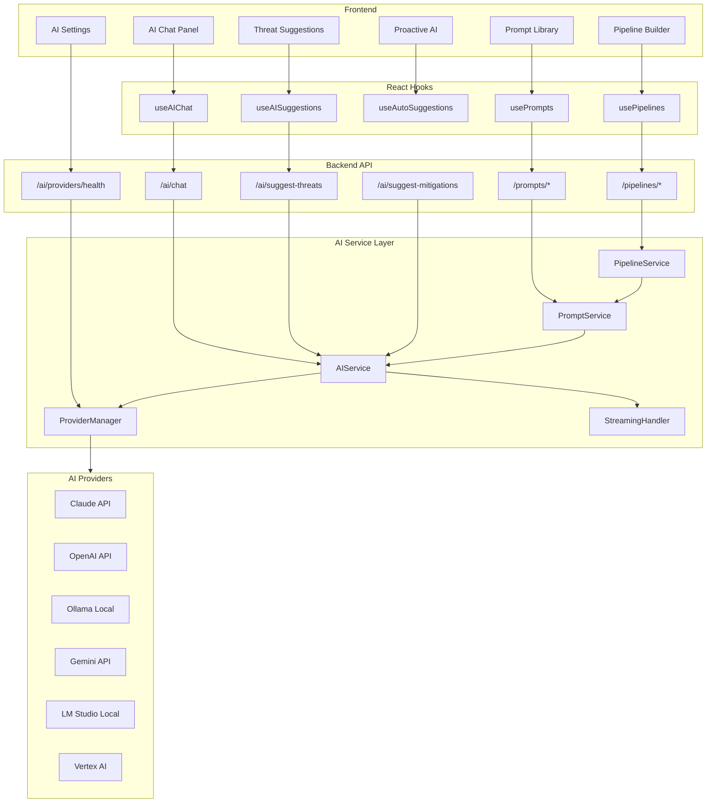
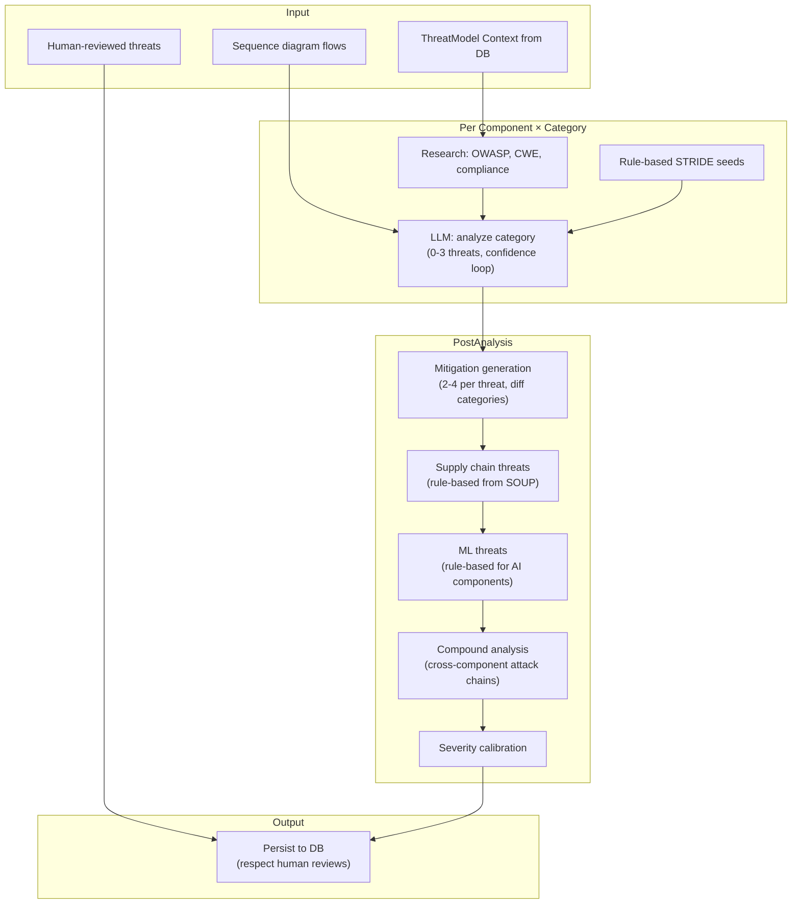
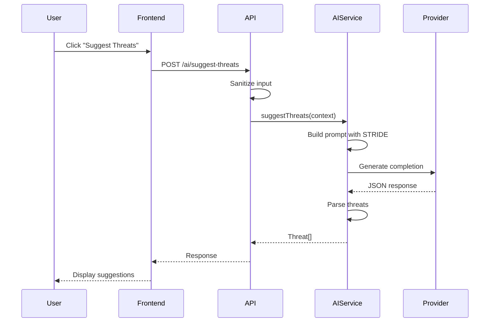
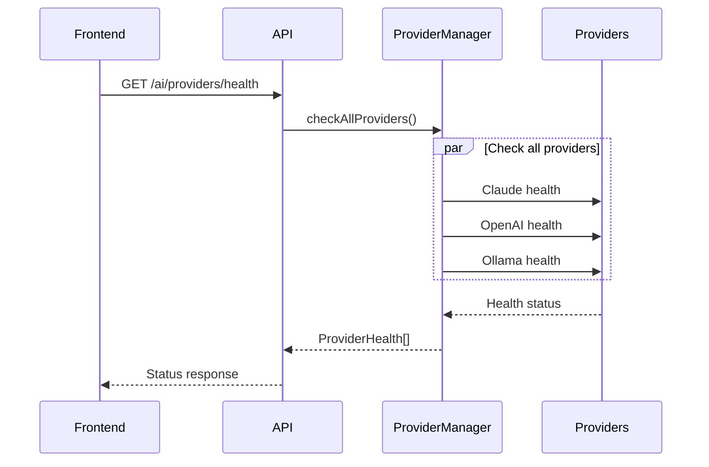

# AI Architecture

AI features are optional. The pipeline for document import, per-component threat analysis, mitigation generation and human review is implemented. Providers are listed under Provider Status below.

Review state for AI output: `AI_SUGGESTED` -> `ACCEPTED` / `REJECTED` / `MODIFIED`.

---

## Current Architecture



---

## Micro-Analysis Pipeline

**Location:** `server/src/services/ai/micro-analysis/`

The micro-analysis pipeline performs deep, per-component threat analysis. Unlike the older 6-pass expert analysis (which analyzes the whole model at once), micro-analysis focuses one LLM call on one component for one threat category, then aggregates.

### Data Flow



### Methodology Support

The methodology selector in the frontend lets users choose which framework(s) to analyze with:

| Methodology | Categories | Use When |
|-------------|-----------|----------|
| STRIDE | 6 | General threat modeling |
| PASTA | 8 | Business-risk-focused analysis |
| Kill Chain | 6 | Attack-path-focused analysis |
| MITRE ATT&CK | 11 | Advanced persistent threat analysis |

Multiple methodologies can run in a single analysis (e.g., STRIDE + PASTA).

### Prompt Architecture

Each category analysis uses a focused prompt (<1500 tokens):
- **System prompt:** Security architect persona, 0-3 threat limit, evidence required
- **User prompt:** Component details, connections, technology, data types, reference data (CWEs, OWASP, compliance, rule-based seeds), sequence flows
- **Safety:** If prompt exceeds 3000 chars, reference sections are trimmed; if 400 error, retries with minimal prompt

### Human-in-the-Loop

Threats persist as `AI_SUGGESTED`. On re-analysis:
- `ACCEPTED`/`REJECTED`/`MODIFIED` threats are **never overwritten**
- Loaded as context: "Previously reviewed threats" injected into prompts
- New threats are created; stale suggestions can be updated

### Dedup & Runaway Prevention (ADR-006)

Eight layered defenses guarantee the pipeline can't accumulate duplicate
threats, run concurrently for the same model, or leak partial writes on
failure. Each is a hard invariant — not a convention that a future
refactor can silently break. See
[ADR-006-threat-dedup-invariants](./decisions/ADR-006-threat-dedup-invariants.md)
for the full rationale.

| Layer | Mechanism | Guards against |
|-------|-----------|---------------|
| **T1.1** Unique constraint | `UNIQUE(threatModelId, COALESCE(componentNodeId, connectionEdgeId, '__compound__'), normalizedName)` | Exact & paraphrase-normalized duplicates |
| **T1.2** Session tagging | `threats.analysisSessionId = aiJob.id` + `cleanupSessionThreats()` | Partial writes from failed/cancelled jobs |
| **T1.3** Canvas-sync orphan sweep | Transactional delete on redraw | Orphan `componentNodeId` accumulation |
| **T2.1** Per-model mutex | Partial unique index on ai_jobs, caught as 409 Conflict | Concurrent `SUGGEST_THREATS` for same model |
| **T2.2** Stale-job skip + startup sweeper | Jobs >30min old → FAILED; session-tagged PENDING rows → deleted | Zombie resume after SIGKILL/OOM/power-loss |
| **T3.1** Paraphrase normalizer | `normalizeThreatName()` — synonym folds + sorted tokens | "Missing auth" vs "Unauthenticated" creating separate rows |
| **T3.2** LLM semantic dedup | Per-component cluster pass with fail-safe fallback | Lexically-distinct but semantically-identical threats |
| **T4.1** Anomaly cap (two layers) | Per-batch (40 in persist), per-run (40 total per component in pipeline) | Single-call hallucinations + pipeline-wide drift |

After T3.2 dedup, the pipeline deletes session-tagged PENDING rows whose
`(targetKey, normalizedName)` isn't in the survivor set — so streaming
writes of collapsed duplicates don't linger in the DB.

### LLM Context Hygiene

Component references in LLM prompts always use human-readable names, never
raw Prisma DB IDs. The LLM tends to parrot opaque identifiers into threat
descriptions ("sends to cmoc3p7nh000907qlizl9gdzl") and produces
significantly worse mitigations when threat text contains CUIDs (measured:
43% mitigation coverage with CUID leakage vs 96% without).

Fixed across four LLM-context builders: `micro-analysis/pipeline.ts`
(`toComponentContext`), `compound-analyzer.ts`, `expert-analysis.ts`
(`formatContext`), `agentic-analysis.ts` (`formatContext` and
`buildContextPrompt`). Each resolves IDs → component names via a lookup
map with `external (<8-char>)` fallback for disconnected refs.

### Key Files

| File | Lines | Purpose |
|------|-------|---------|
| `pipeline.ts` | ~295 | Orchestrator: components → categories → mitigations → compound → calibrate |
| `component-analyzer.ts` | ~162 | Per-component: research + seeds + LLM per category |
| `category-analyzer.ts` | ~289 | Single category analysis + confidence loop + parsing |
| `micro-prompt-builder.ts` | ~353 | Focused prompt construction with reference injection |
| `mitigation-analyzer.ts` | ~93 | Per-threat mitigation generation (separate pass) |
| `compound-analyzer.ts` | ~27+ | Cross-component attack chains |
| `severity-calibrator.ts` | — | Full-context severity adjustment |
| `supplemental-threats.ts` | ~202 | Supply chain + ML rule-based threats |
| `types.ts` | ~100 | MicroThreat, options, methodology category constants |

---

## Provider Status

| Provider | Implementation | Status | File |
|----------|---------------|--------|------|
| **Claude (Anthropic)** | Full | ✅ Working | `claude.ts` |
| **OpenAI** | Full | ✅ Working | `openai.ts` |
| **Ollama** | Full | ✅ Working | `ollama.ts` |
| **Gemini** | Full | ✅ Working | `gemini.ts` |
| **LM Studio** | Full | ✅ Working | `lmstudio.ts` |
| **Vertex AI** | Implemented (service account auth); only config tests | Partial | `vertexai.ts` |

### Provider Features

| Feature | Claude | OpenAI | Ollama | Gemini | LM Studio |
|---------|--------|--------|--------|--------|-----------|
| Chat completion | ✅ | ✅ | ✅ | ✅ | ✅ |
| Streaming | ✅ | ✅ | ✅ | ✅ | ✅ |
| Health check | ✅ | ✅ | ✅ | ✅ | ✅ |
| Model listing | ❌ | ❌ | ✅ | ❌ | ✅ |

---

## Prompt Pipeline System

Configurable AI prompts with multi-stage pipeline execution.

### Components

| Component | File | Purpose |
|-----------|------|---------|
| `PromptService` | `prompt-service.ts` | Template management and execution |
| `PipelineService` | `pipeline-service.ts` | Multi-stage pipeline orchestration |

### Prompt Templates

Templates define reusable AI prompts with:
- **System prompt:** AI persona and instructions
- **User template:** Message with `{{variable}}` placeholders
- **Output format:** JSON, Text, or Markdown
- **Variables:** Typed parameters with defaults
- **Categories:** Classification, Extraction, Analysis, etc.

### Pipeline Execution

Pipelines chain multiple prompts:

```
┌──────────────────────────────────────────────────────────────┐
│                    PIPELINE EXECUTION                         │
├──────────────────────────────────────────────────────────────┤
│                                                               │
│  ┌─────────┐    ┌─────────┐    ┌─────────┐    ┌─────────┐   │
│  │ Stage 1 │───▶│ Stage 2 │───▶│ Stage 3 │───▶│ Result  │   │
│  └─────────┘    └─────────┘    └─────────┘    └─────────┘   │
│       │              ▲              ▲                        │
│       │              │              │                        │
│       └──────────────┴──────────────┘                        │
│              Variable Mapping                                 │
│                                                               │
└──────────────────────────────────────────────────────────────┘
```

**Features:**
- Sequential or parallel stage execution
- Output-to-input variable mapping
- Conditional stage execution
- Retry with exponential backoff
- Real-time execution tracking

### Database Models

| Model | Purpose |
|-------|---------|
| `PromptTemplate` | Prompt configuration |
| `DocumentTypeConfig` | Document detection rules |
| `PromptExecutionLog` | Execution history |
| `PromptPipeline` | Pipeline definition |
| `PipelineStage` | Individual pipeline stage |
| `PipelineExecution` | Pipeline run instance |
| `PipelineStageExecution` | Stage run details |

### API Routes

| Route | Purpose |
|-------|---------|
| `GET /api/organizations/:orgId/prompts` | List prompts |
| `POST /api/organizations/:orgId/prompts` | Create prompt |
| `POST /api/organizations/:orgId/prompts/:id/clone` | Clone prompt |
| `GET /api/organizations/:orgId/pipelines` | List pipelines |
| `POST /api/organizations/:orgId/pipelines/:id/execute` | Run pipeline |
| `GET /api/organizations/:orgId/pipeline-executions/:id` | Execution status |

---

## API Endpoints

### Threat Model AI Endpoints

| Endpoint | Method | Status | Purpose |
|----------|--------|--------|---------|
| `/api/threat-models/:id/ai/available` | GET | ✅ | Check AI availability |
| `/api/threat-models/:id/ai/suggest-threats` | POST | ✅ | Generate threat suggestions |
| `/api/threat-models/:id/ai/suggest-mitigations` | POST | ✅ | Generate mitigations |
| `/api/threat-models/:id/ai/chat` | POST | ✅ | Chat with AI assistant |
| `/api/ai/stream/:id/chat` | GET | ✅ | Streaming chat (SSE) |

### Provider Management

| Endpoint | Method | Status | Purpose |
|----------|--------|--------|---------|
| `/api/ai/providers/health` | GET | ✅ | Global health check |
| `/api/organizations/:id/ai/providers/health` | GET | ✅ | Org-specific health |
| `/api/setup/test-ai` | POST | ✅ | Test provider connection |

---

## Security Implementation

### API Key Security
- ✅ Encrypted at rest (AES-256-GCM)
- ✅ Org-specific encryption keys
- ✅ Decrypted only on-demand
- ✅ Never logged or exposed

### Input Sanitization
- ✅ `sanitizeMessage()` - Prevents prompt injection
- ✅ `sanitizeMessages()` - Sanitizes conversation history
- ✅ `sanitizeObject()` - Request body sanitization

### Rate Limiting
- ✅ Global AI rate limits
- ✅ Per-user throttling
- ⚠️ Cost enforcement (configured, not enforced)

---

## Known Gaps

### 1. Cost Tracking & Enforcement
```typescript
// Settings defined but not enforced:
interface AIGuardrails {
  monthlyBudget: number;      // ← Not enforced
  maxTokensPerRequest: number; // ← Not enforced
}
```

### 2. Multi-Model Orchestration
- Currently: Single model per request
- Missing: Route different tasks to different models

### 3. Advanced Streaming
- Current: Basic SSE works
- Missing: Partial response caching, reconnection handling

---

## Proactive AI (Hybrid Design)

**Location:** `frontend/src/features/proactive-ai/`

### Design Decision
Uses **static threat database** for instant suggestions, not backend AI calls.

**Rationale:**
- Zero latency (instant suggestions)
- Works offline
- No API cost
- Consistent suggestions
- Can be augmented with backend AI

### Data Structure
```typescript
// frontend/src/features/proactive-ai/data/common-threats-by-type.ts
const THREATS_BY_COMPONENT_TYPE = {
  DATABASE: [
    { category: 'tampering', title: 'SQL Injection', severity: 'critical' },
    { category: 'disclosure', title: 'Data Leak', severity: 'high' },
    // ... 50+ threats by type
  ],
  API: [...],
  AUTH: [...],
  // etc.
};
```

### Enhancement Path
1. **Current:** Static database lookup
2. **Future:** Hybrid - static + AI-generated augmentation
3. **Advanced:** Full AI with caching layer

---

## AI Review (Rule-Based)

**Location:** `frontend/src/features/ai-review/`

### Design Decision
Uses **local validation rules**, not AI, for instant feedback.

### Current Rules
```typescript
const validationRules = [
  { check: 'Components have threats', weight: 0.25 },
  { check: 'Critical threats have mitigations', weight: 0.25 },
  { check: 'Trust boundaries defined', weight: 0.20 },
  { check: 'Data flows labeled', weight: 0.15 },
  { check: 'Minimum components present', weight: 0.15 },
];
```

### Enhancement Path
1. **Current:** Rule-based scoring
2. **Future:** AI-powered review with specific recommendations
3. **Advanced:** Continuous AI monitoring with alerts

---

## Roadmap

Items below are planned, not scheduled.

### Stage 1: Core
- [x] Claude, OpenAI, Ollama, Gemini, LM Studio providers
- [x] Chat, suggestions, mitigations
- [x] Streaming support
- [x] Security (encryption, sanitization)
- [ ] Live-tested Vertex AI provider

### Stage 2: Cost Controls
- [ ] Token counting per request
- [ ] Budget enforcement (block when exceeded)
- [ ] Usage dashboard
- [ ] Cost alerts

### Stage 3: Enhanced Proactive AI
- [ ] Hybrid static + AI suggestions
- [ ] Component-specific AI prompts
- [ ] Confidence scoring from AI
- [ ] Suggestion caching

### Stage 4: AI-Powered Review
- [ ] Replace rule-based with AI analysis
- [ ] Specific improvement recommendations
- [ ] Comparison with best practices
- [ ] Gap analysis reports

### Stage 5: Multi-Model Orchestration
- [ ] Route tasks to optimal model
- [ ] Cost-based model selection
- [ ] Quality-based routing
- [ ] Fallback chains

### Stage 6: Advanced Features
- [ ] Conversation memory (cross-session)
- [ ] Fine-tuned threat models
- [ ] Custom prompt templates
- [ ] AI training on org patterns

---

## File Reference

### Backend
```
server/src/
├── api/
│   └── ai.ts                    # API routes (307 lines)
├── services/ai/
│   ├── ai-service.ts            # Core service
│   ├── provider-manager.ts      # Provider management
│   ├── streaming-handler.ts     # SSE streaming
│   ├── ai-metrics.ts            # Usage tracking
│   └── providers/
│       ├── claude.ts            # ✅ Anthropic
│       ├── openai.ts            # ✅ OpenAI
│       ├── ollama.ts            # ✅ Local
│       ├── gemini.ts            # ✅ Google
│       ├── lmstudio.ts          # ✅ Local
│       └── vertexai.ts          # ❌ Stub
└── types/
    └── ai.ts                    # AIProviderClient interface
```

### Frontend
```
frontend/src/features/
├── ai/
│   ├── components/
│   │   └── AIChatPanel.tsx
│   ├── hooks/
│   │   ├── useAIChat.ts
│   │   └── useAISuggestions.ts
│   └── services/
│       └── api.ts
├── proactive-ai/
│   ├── components/
│   │   └── ComponentThreatPopover.tsx
│   ├── hooks/
│   │   └── useAutoSuggestions.ts
│   └── data/
│       └── common-threats-by-type.ts
├── ai-review/
│   └── hooks/
│       └── useAIReview.ts
└── settings/
    └── components/
        ├── AISettingsPanel.tsx
        └── AIGuardrails.tsx
```

---

## Sequence Diagrams

### Threat Suggestion Flow



### Provider Health Check



---

## Configuration

### Environment Variables
```bash
# Cloud Providers (API keys)
ANTHROPIC_API_KEY=sk-ant-...
OPENAI_API_KEY=sk-...
GOOGLE_AI_API_KEY=...

# Local Providers (URLs)
OLLAMA_BASE_URL=http://localhost:11434
LMSTUDIO_BASE_URL=http://localhost:1234/v1

# Encryption
ENCRYPTION_KEY=base64-256-bit-key
```

### Database Settings
```typescript
// Stored per organization
interface AISettings {
  provider: 'anthropic' | 'openai' | 'ollama' | 'gemini' | 'lmstudio';
  model: string;
  apiKey?: string;           // Encrypted
  encryptedApiKey?: string;  // Stored
  baseUrl?: string;          // For local providers
  features: {
    suggestThreats: boolean;
    suggestMitigations: boolean;
    enableChat: boolean;
  };
  guardrails: {
    monthlyBudget: number;
    anonymizeData: boolean;
    logInteractions: boolean;
  };
}
```

---

## Related Documents

- [SADD](./SADD.md) - System architecture
- [Data Flows](./DATA_FLOWS.md) - AI data flow details
- [Backend Architecture](./BACKEND_ARCHITECTURE.md) - Service details

---

*AI implementation is production-ready. Focus on Stage 2-4 for enhancement.*
