# Architecture Diagrams

Visual diagrams for ThreatForge architecture using Mermaid.

---

## System Overview

_Updated May 2026 — 6-container deployment, BullMQ async AI jobs._

```mermaid
graph TB
    subgraph Public["Public Zone"]
        Browser[Web Browser]
        CI[CI/CD Agent<br/>Bearer ftm_xxx]
    end

    subgraph Edge["Edge (Cloudflare + nginx)"]
        CF[Cloudflare CDN<br/>WAF/DDoS]
        Nginx[nginx<br/>SSL termination]
    end

    subgraph App["Application Zone (Docker Compose)"]
        subgraph Frontend["frontend container (Next.js :3000)"]
            App[App Router]
            Canvas[React Flow Canvas<br/>Lucid-Lines LL1-LL4]
            Stores[Zustand Stores<br/>6 slices]
            TQ[TanStack Query<br/>+ AI job poller]
        end

        subgraph Backend["server container (Fastify :3001)"]
            API[REST API<br/>79 route modules]
            WS[WebSocket Server<br/>Yjs collab]
            Services[Services Layer<br/>41+ dirs]
            Worker[BullMQ Worker<br/>10 AI job types]
        end

        Backup[backup container<br/>pg_dump cron]
    end

    subgraph Data["Data Zone"]
        DB[(db container<br/>PostgreSQL 17<br/>84 models)]
        Redis[(redis container<br/>:6379<br/>BullMQ + Yjs)]
    end

    subgraph External["External"]
        AI[AI Providers<br/>Claude/OpenAI/Gemini<br/>Vertex/Ollama/LMStudio]
        OAuth[OAuth/SSO<br/>GitHub/Google/Azure/SAML]
        Trackers[Issue Trackers<br/>Jira/GitHub]
    end

    Browser --> CF
    CI --> CF
    CF --> Nginx
    Nginx -->|/| Frontend
    Nginx -->|/api| Backend
    App --> Canvas
    Canvas --> Stores
    TQ --> API
    Canvas --> WS
    API --> Services
    API --> Worker
    WS --> Services
    Worker --> Redis
    Worker --> AI
    Services --> DB
    Services --> Redis
    Services --> Trackers
    App --> OAuth
    Backup --> DB
```

---

## Frontend Components

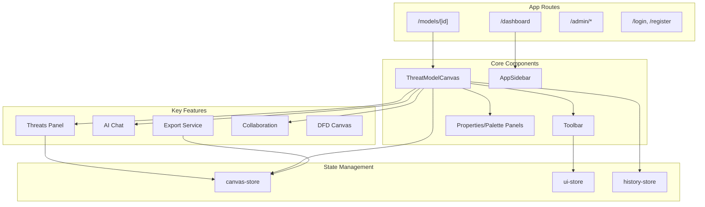

---

## Backend Services

```mermaid
graph TB
    subgraph API["API Layer"]
        ThreatModels[Threat Models API]
        ThreatsAPI[Threats API]
        OrgsAPI[Organizations API]
        AIAPI[AI API]
        AuthAPI[Auth API]
    end

    subgraph Services["Service Layer"]
        AccessControl[Access Control]
        AIService[AI Service]
        Encryption[Encryption]
        Collaboration[Collaboration]
        Audit[Audit Logging]
    end

    subgraph Providers["AI Providers"]
        Claude[Claude]
        OpenAI[OpenAI]
        Gemini[Gemini]
        Ollama[Ollama]
        LMStudio[LM Studio]
    end

    subgraph Data["Data Layer"]
        Prisma[Prisma ORM]
        DB[(PostgreSQL)]
    end

    ThreatModels --> AccessControl
    ThreatsAPI --> AccessControl
    OrgsAPI --> AccessControl
    AIAPI --> AIService
    AuthAPI --> AccessControl

    AccessControl --> Prisma
    AIService --> Providers
    Encryption --> Prisma
    Collaboration --> Prisma
    Audit --> Prisma

    Prisma --> DB
```

---

## Data Model (Core Entities)

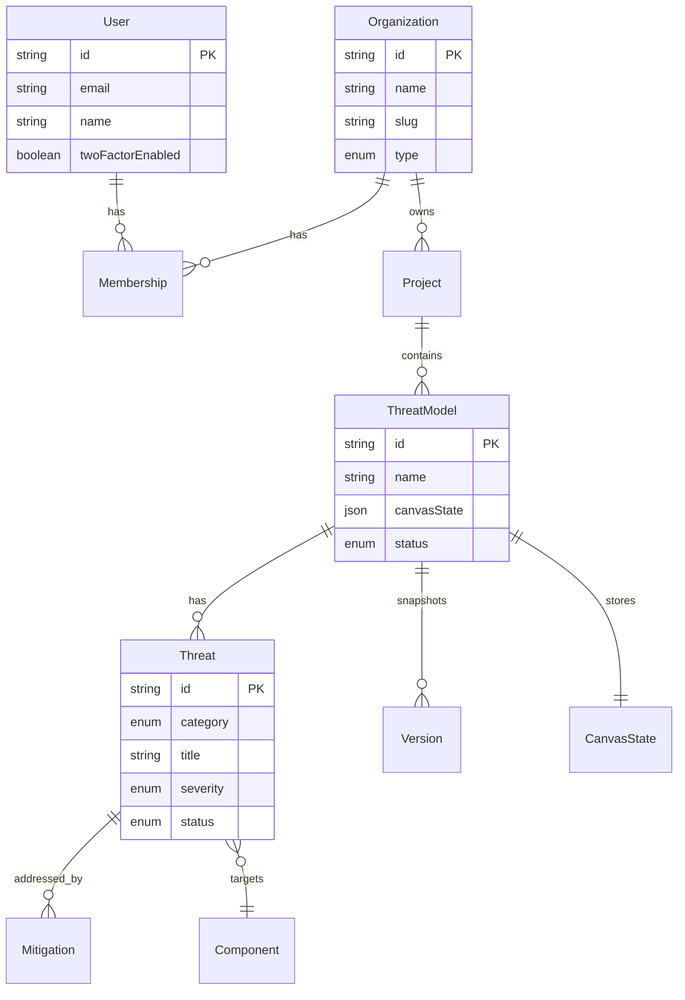

---

## Canvas Load Sequence

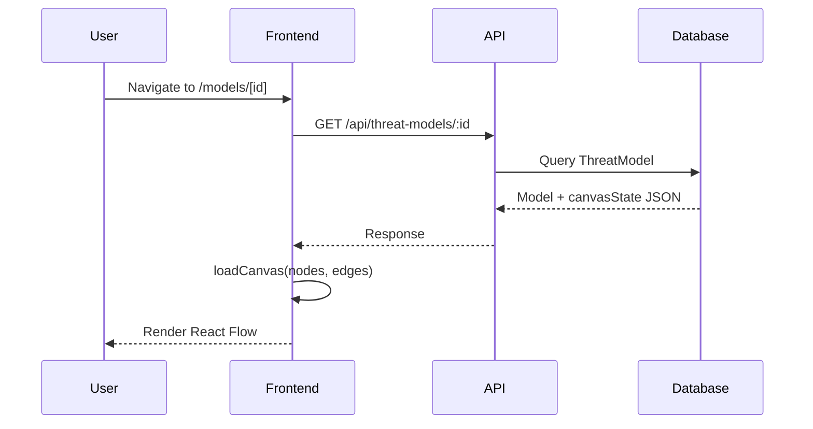

---

## Threat Creation Sequence

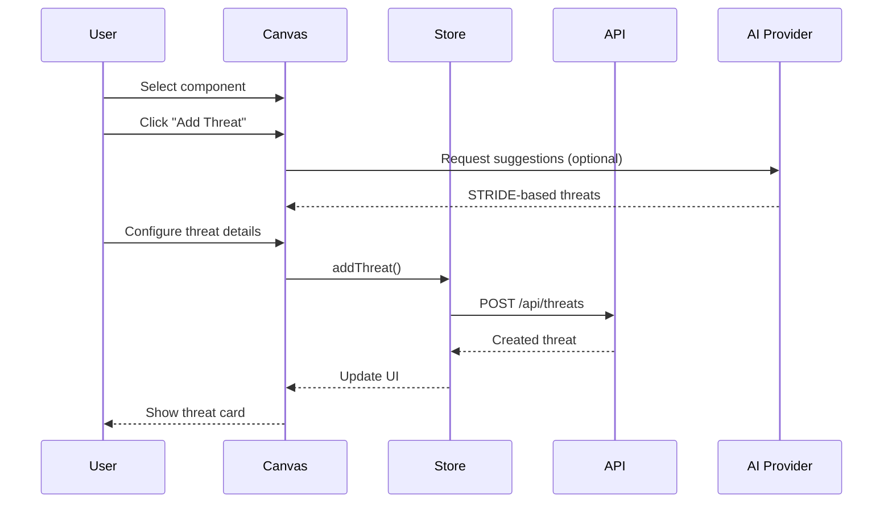

---

## Real-Time Collaboration Sequence

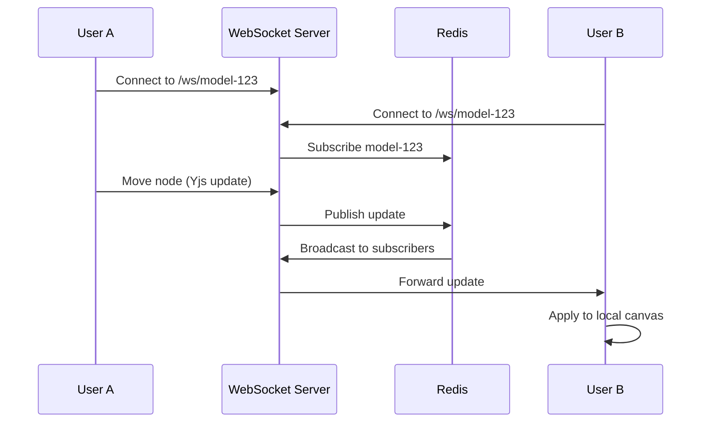

---

## Authentication Flow

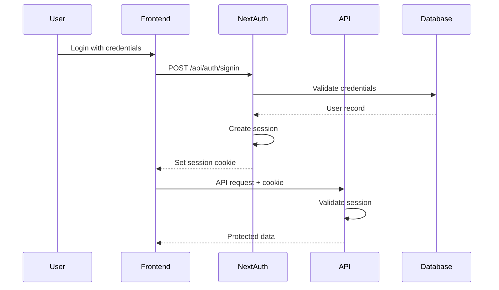

---

## Export Flow

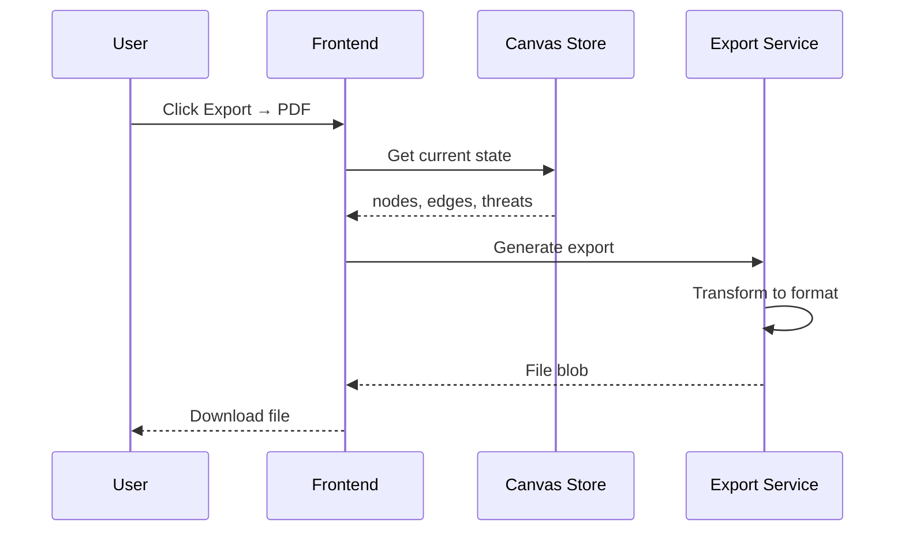

---

## AI Threat Suggestion Flow

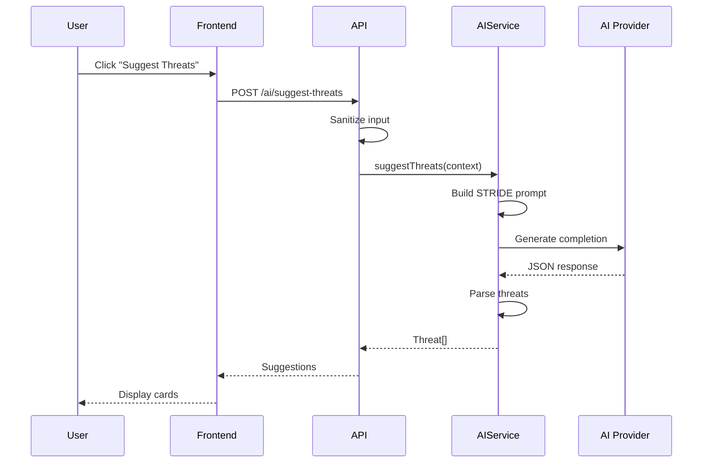

---

## AI Provider Health Check

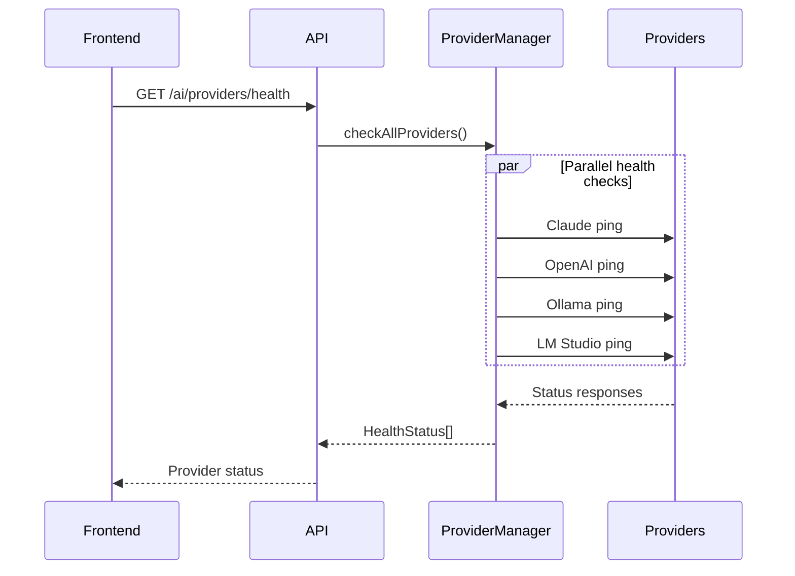

---

## Component Types

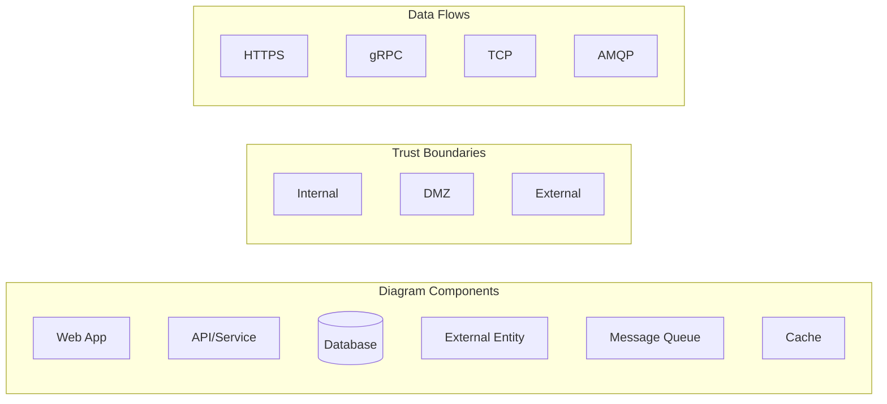

---

## STRIDE Threat Categories

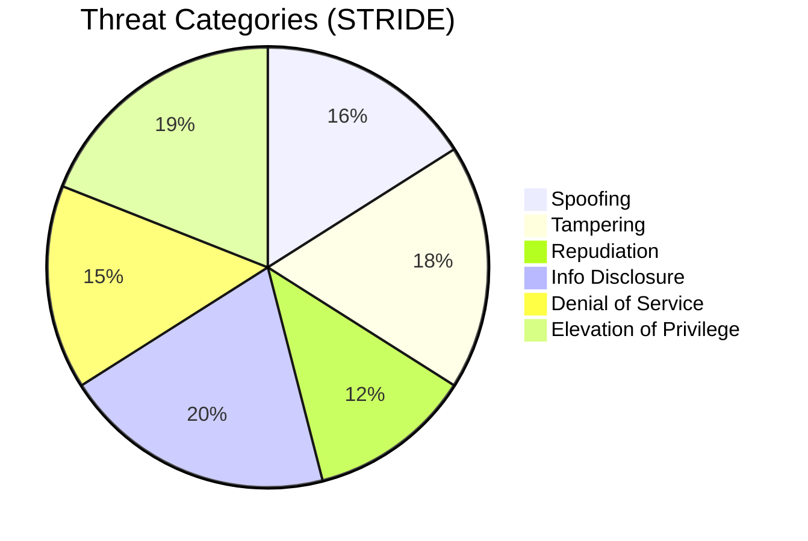

---

## Prompt Pipeline System

### Pipeline Architecture

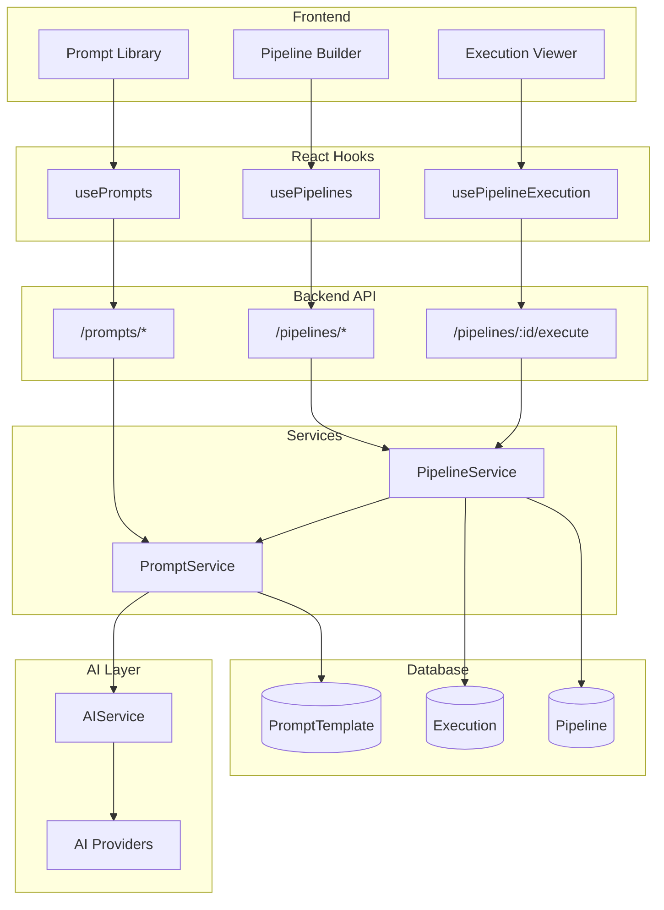

### Pipeline Execution Flow

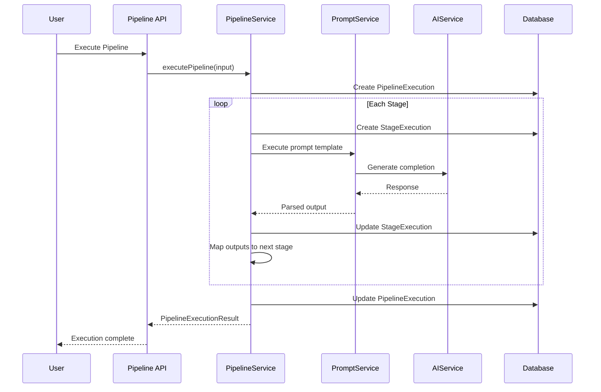

### Prompt Template Flow

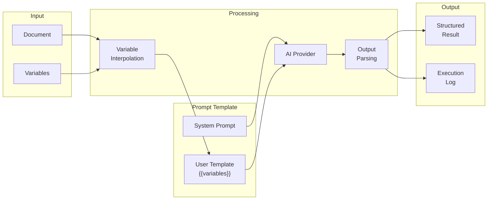

### Document Type Detection

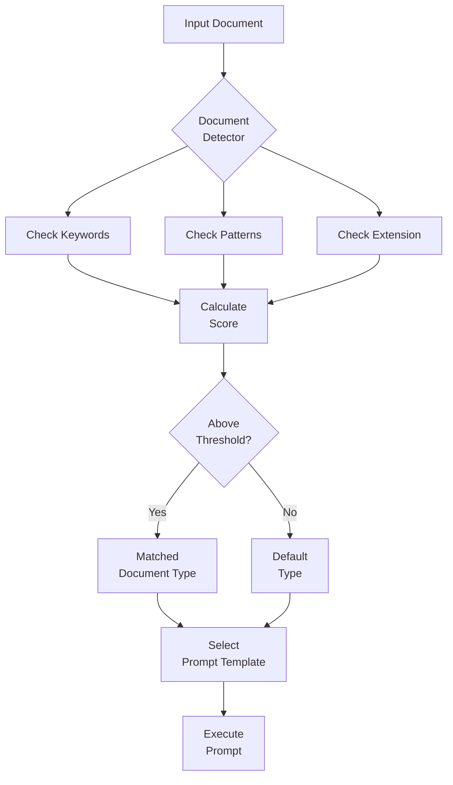

---

*Diagrams render in GitHub, VS Code (with Mermaid extension), and most Markdown viewers.*
