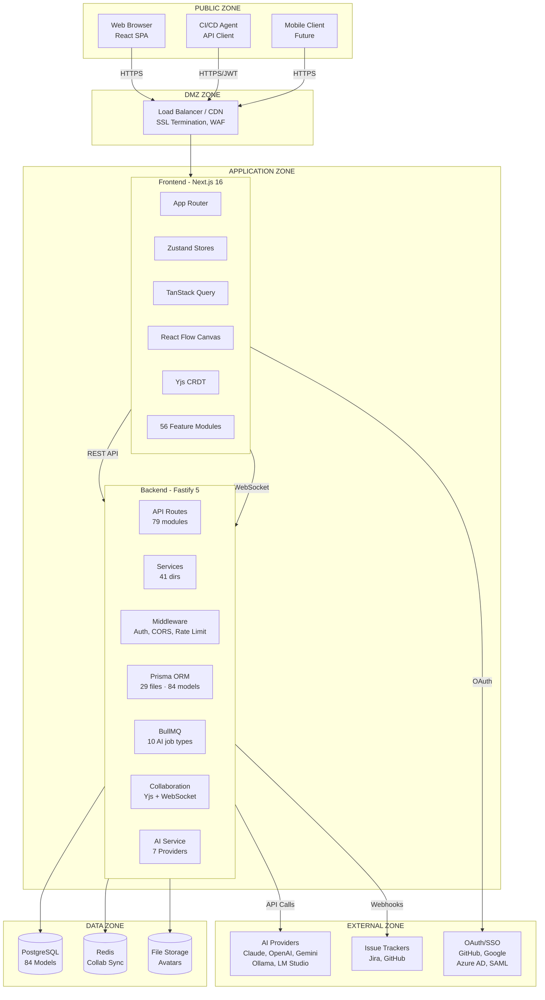
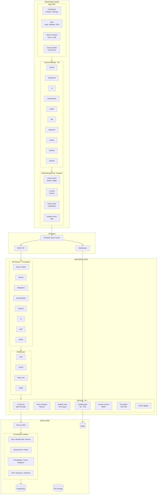
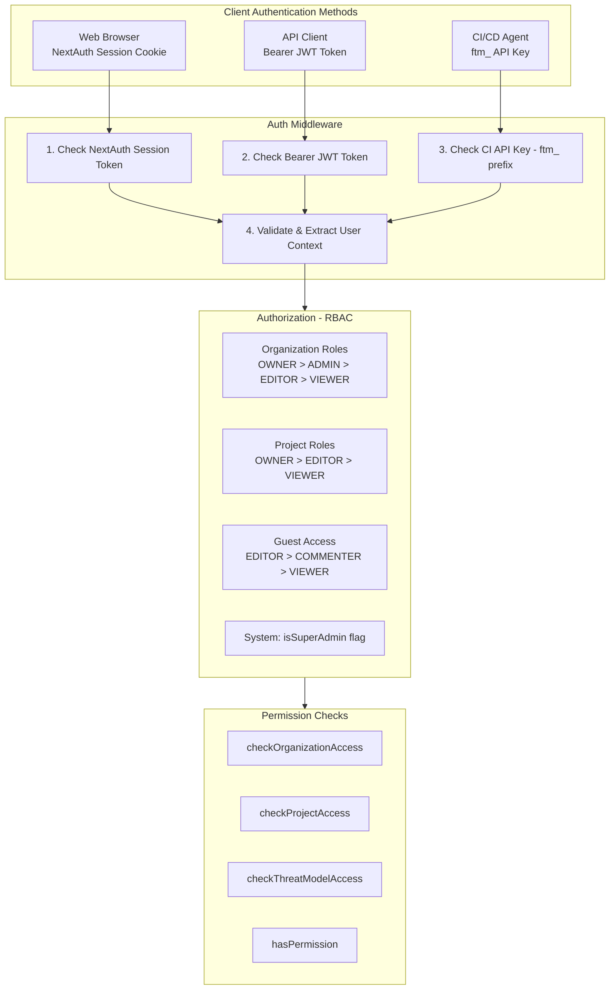
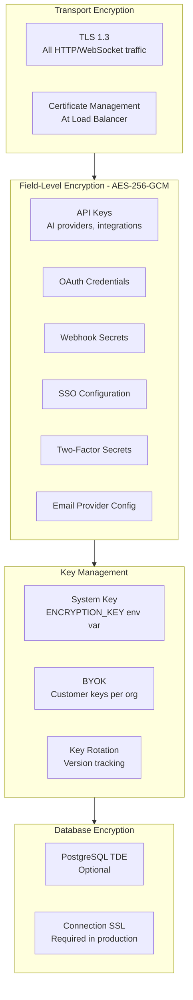
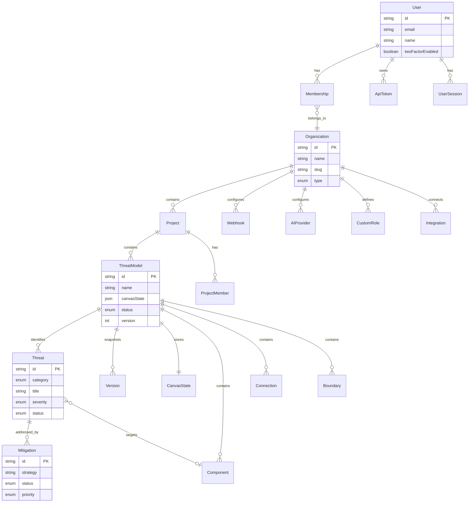
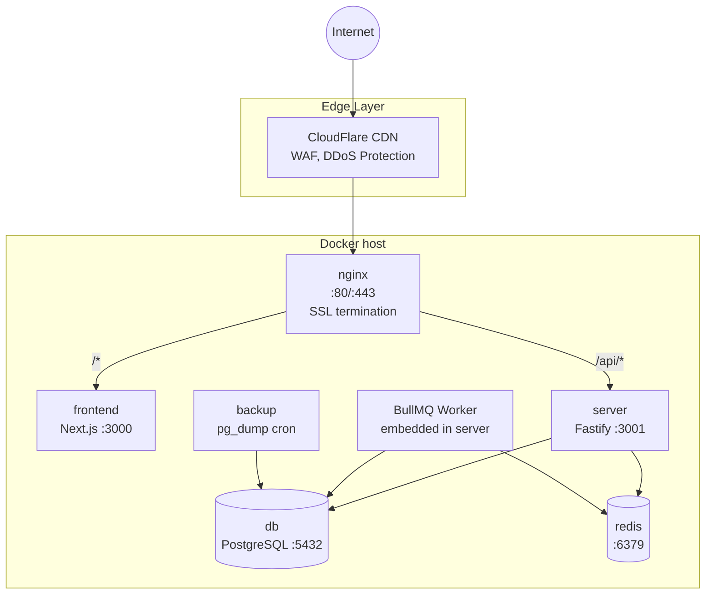
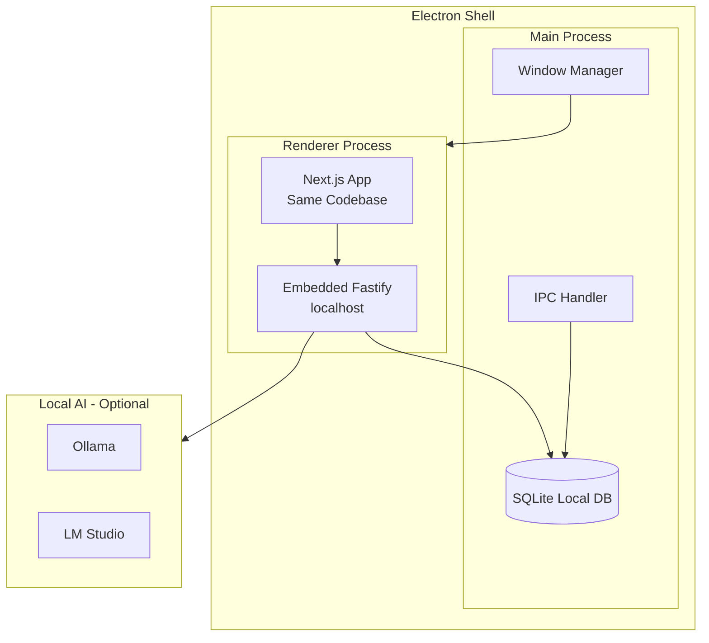

# Software Architecture Design Document (SADD)

**Product:** ThreatForge
**Version:** 2.1
**Last Updated:** May 2026

---

## Table of Contents

1. [System Overview](#1-system-overview)
2. [Architecture Zones](#2-architecture-zones)
3. [Technology Stack](#3-technology-stack)
4. [High-Level Component Diagram](#4-high-level-component-diagram)
5. [Security Architecture](#5-security-architecture)
6. [Data Architecture](#6-data-architecture)
7. [Integration Points](#7-integration-points)
8. [Deployment Architecture](#8-deployment-architecture)
9. [Related Documents](#9-related-documents)

---

## 1. System Overview

ThreatForge is a visual threat modeling platform that enables security teams to create, analyze, and document security threats using the STRIDE methodology with AI-enhanced threat identification.

### Core Capabilities

| Capability | Description |
|------------|-------------|
| **Visual Modeling** | React Flow canvas with Lucid-Lines suite (protocol pills, edge styles, arrowhead picker, label drag) |
| **Multi-Methodology** | STRIDE, PASTA, Kill Chain, MITRE ATT&CK — select per model |
| **Async AI Pipeline** | BullMQ-backed AI jobs: 10 types (suggest threats, mitigations, extract doc, attack tree, etc.) |
| **Micro-Analysis** | Per-component per-category analysis with confidence loops and ADR-006 dedup invariants |
| **Real-time Collaboration** | Yjs CRDT-based concurrent editing over WebSocket + Redis pub/sub |
| **Multi-Diagram Support** | Architecture canvas, DFD, and Sequence diagrams |
| **Compliance Mapping** | 12 frameworks: HIPAA, PCI-DSS 4.0, NIST 800-53, FDA, SOC2, ISO 27001, NIST CSF, OWASP ASVS, CMMC, NIST 800-171, ISO 27701, CCPA (669 controls) |
| **CI/CD Integration** | Threat model scanning in pipelines via public API v1 (9 scopes, Bearer token) |
| **Evidence Traceability** | Mitigations → test criteria → evidence links → SRS/SAD requirement traceability |
| **Smart Document Import** | AI extraction + fuzzy-merge review dialog for SRS/SAD/OpenAPI/Terraform/code |
| **Enterprise Features** | SSO/SAML, RBAC, audit logging, BYOK encryption, SCIM 2.0, custom roles |

---

## 2. Architecture Zones



### Zone Definitions

| Zone | Purpose | Trust Level | Network Access |
|------|---------|-------------|----------------|
| **Public** | End-user clients, CI/CD agents | Untrusted | Internet |
| **DMZ** | Edge services, SSL termination | Low | Internet ↔ Internal |
| **Application** | Frontend and backend services | Medium | Internal only |
| **Data** | Databases, caches, storage | High | Application zone only |
| **External** | Third-party APIs | Low | Outbound only |

---

## 3. Technology Stack

### Frontend Stack

| Layer | Technology | Version | Purpose |
|-------|------------|---------|---------|
| Framework | Next.js | 16.x | React meta-framework with App Router |
| UI Library | React | 19.x | Component-based UI |
| Language | TypeScript | 5.x | Type safety |
| Diagramming | @xyflow/react | 12.x | Node-based canvas (React Flow) |
| State (Client) | Zustand | 5.x | Lightweight client state |
| State (Server) | TanStack Query | 5.x | Server state & caching |
| Collaboration | Yjs | 13.x | CRDT-based real-time sync |
| Styling | Tailwind CSS | 4.x | Utility-first CSS |
| Components | shadcn/ui | - | Accessible component library |

### Backend Stack

| Layer | Technology | Version | Purpose |
|-------|------------|---------|---------|
| Runtime | Node.js | 22.x | JavaScript runtime |
| Framework | Fastify | 5.x | High-performance web framework |
| Language | TypeScript | 5.x | Type safety |
| ORM | Prisma | 7.x | Database abstraction |
| Auth | Auth.js | 5.x | Authentication (NextAuth) |
| AI | Custom Provider | - | Multi-provider AI abstraction (Claude, OpenAI, Gemini, Ollama, LM Studio, Vertex AI) |

### Data Layer

| Component | Technology | Purpose |
|-----------|------------|---------|
| Primary DB | PostgreSQL 17 | Relational data storage |
| Desktop DB | SQLite | Local-first desktop mode |
| Cache/Sync | Redis | Collaboration state, pub/sub |
| Encryption | AES-256-GCM | Field-level encryption |

### Infrastructure

| Component | Technology | Purpose |
|-----------|------------|---------|
| Container | Docker | Containerization (6 containers: nginx, frontend, server, db, redis, backup) |
| Job Queue | BullMQ + Redis | Async AI job processing |
| CI/CD | Your own deploy script or pipeline (optional) | Rebuilds the Compose stack on push |
| Proxy | nginx | SSL termination, static asset serving, API routing |

---

## 4. High-Level Component Diagram



---

## 5. Security Architecture

### Authentication Flow



### Encryption Architecture



### User Security Controls

| Control | Description | Configurable |
|---------|-------------|--------------|
| **Two-Factor Auth (TOTP)** | Time-based OTP with backup codes | Per user |
| **MFA Enforcement** | Require 2FA for all users | System setting |
| **Password Policy** | Min length, complexity requirements | System setting |
| **Account Lockout** | Auto-lock after failed attempts | System setting |
| **Session Timeout** | Configurable session duration | System setting |
| **User Suspension** | Admin can suspend user accounts | Per user |
| **API Tokens** | Personal access tokens with scopes | Per user |

### Admin Security Features

| Feature | Location | Description |
|---------|----------|-------------|
| **System Settings** | `/admin/settings` | 7 tabs of security configuration |
| **User Management** | `/admin/users` | View, promote, suspend, bulk import |
| **Audit Logs** | `/admin/audit` | Full activity tracking with export |
| **IP Allowlist** | System settings | Restrict access by IP/CIDR |
| **OAuth Management** | System settings | Dynamic provider configuration |

### Custom Role Permissions

Fine-grained permissions beyond default roles (OWNER/ADMIN/EDITOR/VIEWER):

```typescript
// Permission types
models:read, models:create, models:update, models:delete
threats:read, threats:create, threats:update, threats:delete
members:read, members:invite, members:manage
settings:read, settings:update
projects:read, projects:create, projects:update, projects:delete

// Access control service
hasCustomPermission(userId, orgId, permission)
hasAllPermissions(userId, orgId, permissions[])
hasAnyPermission(userId, orgId, permissions[])
```

---

## 6. Data Architecture

### Entity Relationship Overview



### Canvas State Storage

The threat model canvas is stored as a JSON blob containing React Flow state:

```json
{
  "nodes": [
    {
      "id": "node-1",
      "type": "componentNode",
      "position": { "x": 100, "y": 200 },
      "data": {
        "type": "WEB_APP",
        "label": "Frontend",
        "trustLevel": "EXTERNAL",
        "properties": {}
      }
    }
  ],
  "edges": [
    {
      "id": "edge-1",
      "source": "node-1",
      "target": "node-2",
      "data": {
        "protocol": "HTTPS",
        "authentication": "JWT",
        "encrypted": true
      }
    }
  ],
  "viewport": {
    "x": 0,
    "y": 0,
    "zoom": 1
  }
}
```

**Sync Strategy:** Canvas JSON is authoritative; normalized tables (Component, Connection, Boundary) are populated on-demand via `canvas-sync` service.

---

## 7. Integration Points

### External System Integrations

```mermaid
graph TB
    subgraph AI["AI Providers"]
        Claude[Claude<br/>Cloud]
        OpenAI[OpenAI<br/>Cloud]
        Gemini[Gemini<br/>Cloud]
        Ollama[Ollama<br/>Local]
        LMStudio[LM Studio<br/>Local]
    end

    subgraph AILayer["AI Service Layer"]
        ProviderMgr[Provider Manager<br/>Health & Fallback]
    end

    subgraph Trackers["Issue Trackers"]
        Jira[Jira]
        GitHub[GitHub Issues]
    end

    subgraph TrackersFuture["Issue Trackers (Planned)"]
        Azure[Azure DevOps]
        Linear[Linear]
        Asana[Asana]
    end

    subgraph IntegLayer["Integration Service"]
        IntegSvc[Integration Service<br/>+ Mappings]
    end

    subgraph AuthProviders["Authentication Providers"]
        GitHubOAuth[GitHub OAuth]
        GoogleOAuth[Google OAuth]
        AzureAD[Azure AD OIDC]
        Okta[Okta OIDC]
        SAML[SAML<br/>BoxyHQ]
    end

    subgraph AuthLayer["Auth Layer"]
        AuthJS[Auth.js<br/>NextAuth]
    end

    Claude --> ProviderMgr
    OpenAI --> ProviderMgr
    Gemini --> ProviderMgr
    Ollama --> ProviderMgr
    LMStudio --> ProviderMgr

    Jira --> IntegSvc
    GitHub --> IntegSvc
    Azure -.-> IntegSvc
    Linear -.-> IntegSvc
    Asana -.-> IntegSvc

    GitHubOAuth --> AuthJS
    GoogleOAuth --> AuthJS
    AzureAD --> AuthJS
    Okta --> AuthJS
    SAML --> AuthJS
```



### Webhook Events

| Event Category | Events |
|----------------|--------|
| **Threats** | threat.created, threat.updated, threat.deleted |
| **Mitigations** | mitigation.created, mitigation.updated, mitigation.deleted |
| **Models** | model.created, model.updated, model.deleted, model.exported |
| **Members** | member.invited, member.joined, member.removed |
| **Projects** | project.created, project.deleted |

---

## 8. Deployment Architecture

### Docker Compose Deployment



**Deploy flow (optional):** a deploy script or pipeline on the host rebuilds the images, runs `prisma db push` and restarts the containers. See [DEPLOYMENT.md](../DEPLOYMENT.md) for the manual path.

In the diagram, the CDN/WAF layer is optional; nginx can face the internet directly.

### Desktop Deployment (Electron) - Planned

> **Note:** Desktop/Electron deployment is a planned feature, not yet implemented.



**Desktop Mode:**
- Database: SQLite (local file: `~/.threatforge/data.db`)
- AI: Ollama/LM Studio (local) or Cloud APIs (if configured)
- Collaboration: Local only (single user)

---

## 9. Related Documents

| Document | Description |
|----------|-------------|
| [Frontend Architecture](./FRONTEND_ARCHITECTURE.md) | Detailed frontend component architecture |
| [Backend Architecture](./BACKEND_ARCHITECTURE.md) | Detailed backend service architecture |
| [Data Flows](./DATA_FLOWS.md) | Request/response data flow documentation |
| [Diagrams](./DIAGRAMS.md) | Mermaid visual diagrams (components, sequences) |
| [AI Architecture](./AI_ARCHITECTURE.md) | AI implementation status & roadmap |
| [Features Guide](../FEATURES.md) | Feature module documentation |
| [API Reference](../API_REFERENCE.md) | REST API endpoint reference |
| [Data Models](../DATA_MODELS.md) | Database schema documentation |

---

*This document is maintained as the authoritative source for system architecture decisions.*
