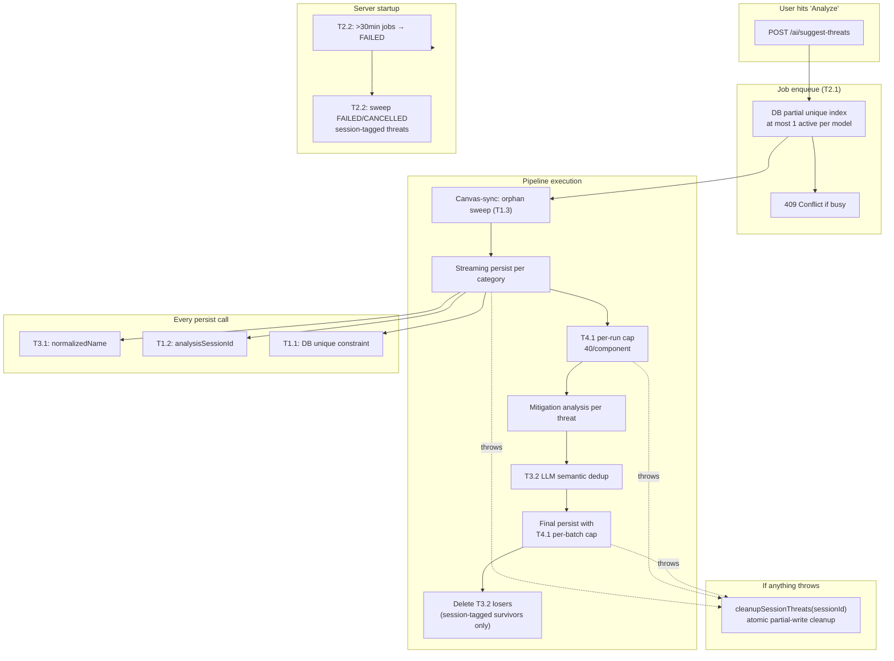

# ADR-006: Threat-Generation Dedup Invariants & Runaway Prevention

**Status:** Accepted
**Date:** 2026-04-23
**Decision Makers:** Architecture Team
**Supersedes:** N/A
**Related:** ADR-005 (Multi-Provider AI)

---

## Context

The micro-analysis pipeline ran away on a 12-component model, producing 776
threats across multiple analysis runs (expected: ~60-80). Root-cause audit
surfaced five compounding failure modes, none of which had a structural
defense:

1. **Retry amplification** — BullMQ `attempts: 2` silently re-ran a 2-hour
   pipeline on any thrown error. Auto-recovery on server restart re-enqueued
   interrupted jobs. A "checkpoint all IDs stale" fallback silently restarted
   the pipeline from zero when the canvas was redrawn mid-run. Every retry
   re-seeded the full threat set.
2. **Concurrent writers** — Two `SUGGEST_THREATS` jobs could run
   simultaneously for the same model; nothing blocked it.
3. **Orphan accumulation** — `Threat.componentNodeId` is plain text, no FK.
   When a user redraws the canvas, old-nodeId threats linger forever. 29 of
   41 distinct componentNodeIds in the runaway dataset pointed to deleted
   components.
4. **Weak dedup** — The existing `normalizeKey` stripped punctuation only.
   LLM paraphrase variants ("Missing auth on gRPC" vs "gRPC lacks auth" vs
   "Unauthenticated gRPC endpoint") all produced distinct keys and wrote
   as separate rows. 593 distinct names across 776 threats → 183
   near-duplicates.
5. **Partial-write ambiguity** — Streaming persist wrote threats
   mid-pipeline for UX; if the job failed, partial rows lingered with no
   way to clean them up selectively.

The bug class is "dedup by convention" — every code path that writes a
threat has to remember to check for duplicates, handle concurrent writers,
clean up on failure, and cap anomalies. Any future refactor can silently
break one of those invariants.

---

## Decision

Move dedup + runaway prevention from convention to **hard DB invariants**.
Eight layered defenses, composable, each independently verifiable.

### T1 — Database invariants

**T1.1. Unique constraint on threats.**

```sql
CREATE UNIQUE INDEX threats_dedup_unique_idx
  ON threats (
    "threatModelId",
    COALESCE("componentNodeId", "connectionEdgeId", '__compound__'),
    "normalizedName"
  )
  WHERE "normalizedName" IS NOT NULL;
```

The `COALESCE` sentinel prevents Postgres's "NULLs are distinct" default
from creating a hole for compound threats and connection-edge threats.
Functional index — not expressible in Prisma schema, maintained via raw
SQL migration.

**T1.2. Analysis session provenance.**

New column: `threats.analysisSessionId TEXT` — set to `aiJob.id` on every
insert. Enables atomic cleanup when a job fails/cancels without affecting
human-reviewed rows.

**T1.3. Canvas-redraw orphan sweep.**

Inside the `canvas-sync` transaction, after `component.deleteMany`, delete
all AI-suggested PENDING threats whose `componentNodeId` isn't in the
incoming node set. Human-reviewed and manually-edited rows preserved.

### T2 — Single-writer discipline

**T2.1. Per-model job mutex.**

```sql
CREATE UNIQUE INDEX ai_jobs_one_active_suggest_per_model_idx
  ON ai_jobs ("threatModelId")
  WHERE status IN ('QUEUED', 'PROCESSING')
    AND type = 'SUGGEST_THREATS'
    AND "threatModelId" IS NOT NULL;
```

Partial unique index. Second concurrent INSERT raises `23505`, caught by
`createSuggestThreatsJob` helper, returned to the route as HTTP 409
Conflict. TOCTOU-proof — no application-layer race.

**T2.2. Stale-job skip + startup sweeper.**

On server startup: only auto-requeue PROCESSING jobs with `startedAt <
30min ago`. Stale jobs are marked FAILED with reason "recovery skipped —
job stale." Then a sweeper deletes any AI_SUGGESTED PENDING threats
tagged with a FAILED/CANCELLED session id — the safety net for
SIGKILL/OOM/power-loss where the in-process cleanup hook didn't run.

Also: `BullMQ attempts: 2 → 1`. A 2-hour pipeline must never silently
retry. User-driven retries go through the retry endpoint which resumes
from checkpoint.

### T3 — Dedup quality

**T3.1. Paraphrase-resistant normalizer.**

`normalizeThreatName(name)` folds common STRIDE paraphrase patterns
(`unauthenticated` → `missing auth`, `lack of X` → `missing X`,
`authenticated` → `auth`, `encrypted` → `encryption`, etc.), strips
stopwords, stems common security-vocab plurals, then tokenizes and sorts
alphabetically to produce a word-order-invariant canonical form.

Stored as `threats.normalizedName` on every insert. The DB unique
constraint uses this as its third column.

**T3.2. Non-load-bearing LLM semantic dedup pass.**

Pipeline-final stage: for each component, one local-LLM call asks it to
cluster threats as paraphrases. Keeps highest-confidence representative
per cluster. Catches semantic duplicates that T3.1's lexical normalizer
misses ("SQL injection" vs "Improper parameter binding").

**Failure-safe contract:** any LLM error, malformed JSON, empty clusters,
or forgotten indices falls back to the unmodified input. T3.2 can only
*prune*; it can never *lose* threats.

**Post-T3.2 cleanup:** Streaming persist writes every threat during
analysis (for progress UX). T3.2 reduces the set, but the losers remain
in the DB from the streaming write. After the final persist, we compute
the survivor key set and delete any session-tagged row whose key isn't
in the survivor set. Without this step, the DB accumulates T3.2 casualties
with no mitigations (the mitigation pass only runs on winners in the
final list).

### T4 — Safety nets

**T4.1. Two-layer anomaly cap.**

- **Per-batch** (in `persistAIThreats`): if any component in the batch
  has >40 threats, abort the entire batch. Catches single-call LLM
  hallucinations.
- **Per-run** (in `pipeline.ts`): track per-component emission totals
  across all streaming calls in one pipeline execution. Cross 40 → throw.
  The failure handler's `cleanupSessionThreats` wipes the partial writes.
  Catches multi-call pipeline-wide anomalies that per-batch misses.

Cap is 40 because STRIDE has 6 categories × ~3 threats/category = 18
expected; MITRE ATT&CK can legitimately reach ~33 across 11 categories.
Over 40 is a loop or hallucination.

### Cross-cutting: LLM context hygiene

A separate but related bug: the LLM was being fed raw Prisma DB IDs
(CUIDs) as connection endpoints and component references. It parroted
them into threat descriptions ("sends to `cmoc3p7nh000907qlizl9gdzl`"),
and mitigation generation failed 57% more often on CUID-containing
threats (LLM can't reason about opaque identifiers).

Fixed in four LLM-context builders — `micro-analysis/pipeline.ts`,
`compound-analyzer.ts`, `expert-analysis.ts`, `agentic-analysis.ts`. All
now resolve IDs to component names before constructing prompts, with
`external (<8-char-prefix>)` fallback for disconnected refs.

---

## Composition — how the layers interact



---

## Consequences

### Positive

- **Dedup is a DB invariant, not a convention.** Any code path writing
  threats is physically prevented from creating duplicates on the same
  `(model, target, normalizedName)` tuple. A future refactor that
  removes the app-level dedup check can't regress.
- **Concurrent writers are physically impossible.** 409 is the only
  possible outcome when two analyses race for the same model.
- **Failed runs self-clean.** Session tagging + cleanup hook + startup
  sweeper form three redundant cleanup layers. Even SIGKILL leaves no
  partial state.
- **Runaway is caught at two layers.** Per-batch stops single-call
  hallucinations, per-run stops pipeline-wide drift.
- **Semantic dedup is opt-in pruning, not risk.** T3.2 can fail any way
  and never loses threats.

### Negative / Risks

- **Schema migration is destructive.** The unique constraint requires
  wiping AI_SUGGESTED PENDING rows whose normalizedName would collide.
  Documented in `server/prisma/migrations/add-threat-dedup.sql`. Run
  once; subsequent deploys are no-ops.
- **`normalizedName` goes stale if the algorithm changes.** When
  `normalizeThreatName()` is updated, human-reviewed survivors keep
  their old normalized keys and could block future inserts. Mitigation:
  either add a migration to recompute on algorithm change, or keep the
  normalizer backward-compatible (additive rewrites only).
- **T3.2 latency overhead.** One local-LLM call per component. For a
  12-component model with local LM Studio, adds ~30-60s. Acceptable
  given the pipeline already runs 20-30 minutes.
- **Startup sweeper runs on every boot.** A model with many FAILED
  sessions could see a large DELETE on startup. Indexed by
  `analysisSessionId` so query is cheap; empirically <100ms even with
  1000s of dead sessions.

### What we explicitly chose NOT to do

- **Per-component max threat cap in steady state.** Advisor suggested
  "max 15 AI threats per component ever." Rejected — masks real
  complexity in enterprise models. T4.1 caps emissions per *run*, not
  total.
- **Cancel active jobs on canvas redraw.** A user who redraws mid-run
  loses ~10 minutes of analysis but keeps human-reviewed data. The
  canvas-sync orphan sweep handles the nodeId-drift consequence without
  the UX hit of cancelling the job.
- **Semantic dedup via embeddings.** Considered using a local embedding
  model for cluster detection. Rejected for T3.2 — LLM prompt clustering
  is simpler, works with any model, and can be swapped for embeddings
  later without changing the pipeline shape.

---

## Verification

**Unit tests (19, all passing):**
- `normalize-threat-name.test.ts` — 14 tests for T3.1 paraphrase pairs
- `cleanup-session.test.ts` — 3 tests for T1.2 cleanup guards (sacred
  invariants: ACCEPTED survives, manually-edited survives, wrong-session
  survives)
- `create-suggest-threats-job.test.ts` — 4 tests for T2.1 mutex (P2002
  conflict path, non-P2002 errors bubble up)
- `anomaly-cap.test.ts` — 4 tests for T4.1 per-batch (40/41 boundary,
  batch-level vs cumulative-DB)
- `llm-dedup.test.ts` — 8 tests for T3.2 fail-safe (LLM throw/garbage →
  original set, forgotten indices → singletons, confidence tie-breakers)

**Test coverage plan (32 additional tests specified, future work):**
`server/src/services/threat-review/__tests__/TEST_COVERAGE_PLAN.md`
covers the remaining surfaces with Arrange/Act/Assert for each.

**Production verification (2026-04-23):**
- Pre-fix: 776 threats across 41 componentNodeIds (29 orphaned), 593
  distinct names, 57% mitigation coverage
- Post-fix: 77 threats across 12 live components, 0 orphans, 100%
  mitigation coverage, 0 duplicate names

---

## Files changed

| File | Purpose |
|------|---------|
| `server/prisma/schema/07-threats.prisma` | `analysisSessionId`, `normalizedName`, indexes |
| `server/prisma/migrations/add-threat-dedup.sql` | Destructive one-time migration |
| `server/src/services/threat-review/normalize-threat-name.ts` | T3.1 normalizer |
| `server/src/services/threat-review/review-service.ts` | `persistAIThreats` with session tags + T4.1 per-batch + `cleanupSessionThreats` |
| `server/src/services/ai/micro-analysis/pipeline.ts` | T4.1 per-run cap + T3.2 integration + loser cleanup |
| `server/src/services/ai/micro-analysis/llm-dedup.ts` | T3.2 implementation |
| `server/src/services/ai/micro-analysis/compound-analyzer.ts` | CUID hygiene |
| `server/src/services/ai/expert-analysis.ts` | CUID hygiene |
| `server/src/services/ai/agentic-analysis.ts` | CUID hygiene |
| `server/src/services/canvas-sync.ts` | T1.3 orphan sweep |
| `server/src/jobs/create-suggest-threats-job.ts` | T2.1 mutex helper |
| `server/src/jobs/ai-queue.ts` | `attempts: 1` |
| `server/src/jobs/ai-worker.ts` | `cleanupSessionThreats` on fail |
| `server/src/index.ts` | T2.2 stale-job skip + startup sweeper |

Commits: `a46b924`, `44b4a28`, `1020ddd`, `e5d73da`, `0438e66`, `18d0c89`.
