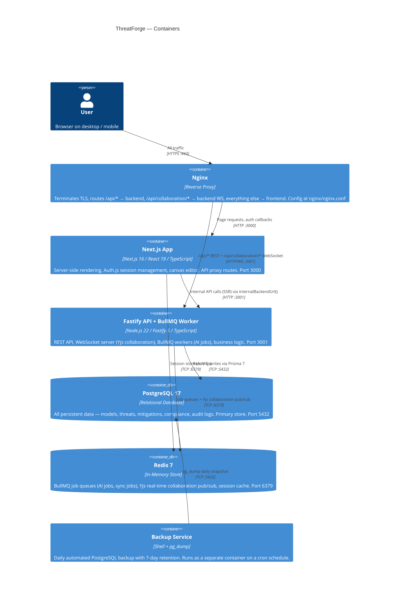
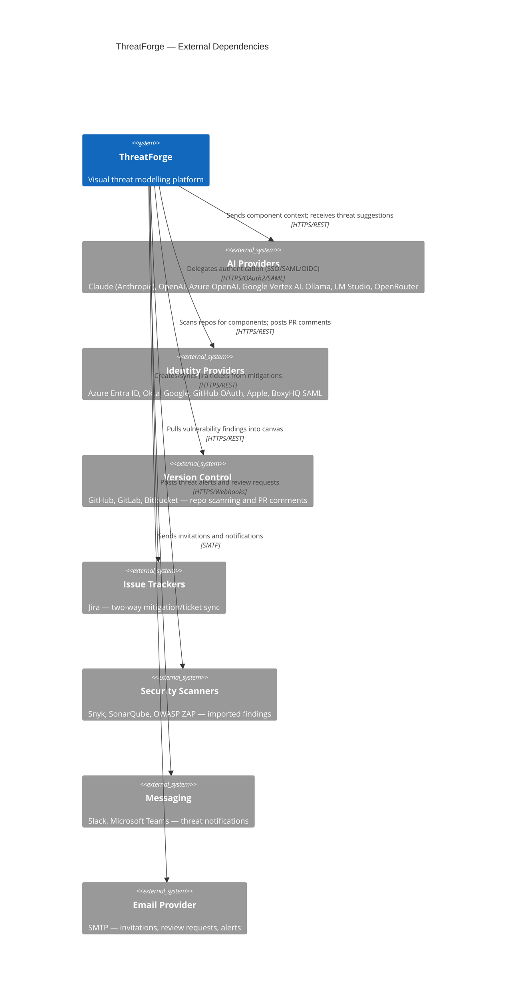

# ThreatForge — C2 Container Diagram

_Derived from `docs/sdlc/C4_ARCHITECTURE.md`. All six runtime containers._

---

---

## Container Responsibilities

| Container | Owns | Does NOT own |
|-----------|------|--------------|
| **Nginx** | TLS termination, routing, WebSocket upgrade, static file caching | Business logic, auth |
| **Next.js** | UI rendering, Auth.js sessions, server actions, API proxy | AI processing, DB writes |
| **Fastify** | All business logic, AI jobs, WebSocket server (Yjs), data persistence | UI rendering, session cookies |
| **PostgreSQL** | Durable state for all domain objects | Ephemeral state, queues |
| **Redis** | Job queues (BullMQ), Yjs pub/sub, session cache | Durable business data |
| **Backup** | Scheduled pg_dump, 7-day retention, stored on host volume | Serving requests |

---

## External Systems

