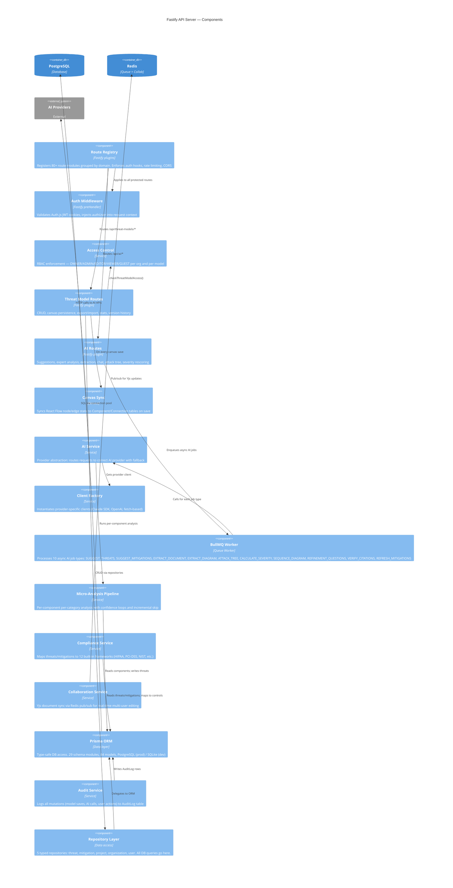
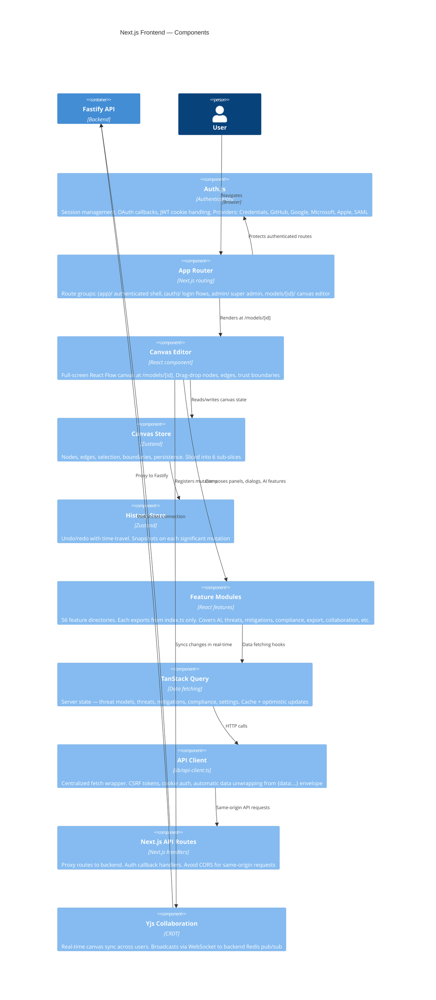
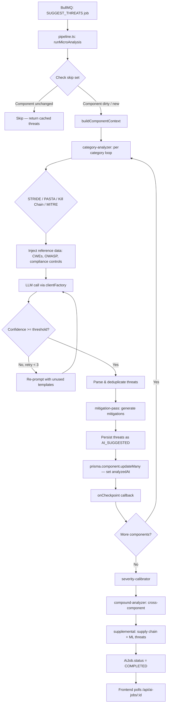

# ThreatForge — C3 Component Diagrams

_Derived from `docs/sdlc/C4_ARCHITECTURE.md`. Internal structure of backend and frontend._

---

## Fastify API Server — Components

---

## Next.js Frontend — Components

---

## Micro-Analysis Pipeline — Level 4 Flow

