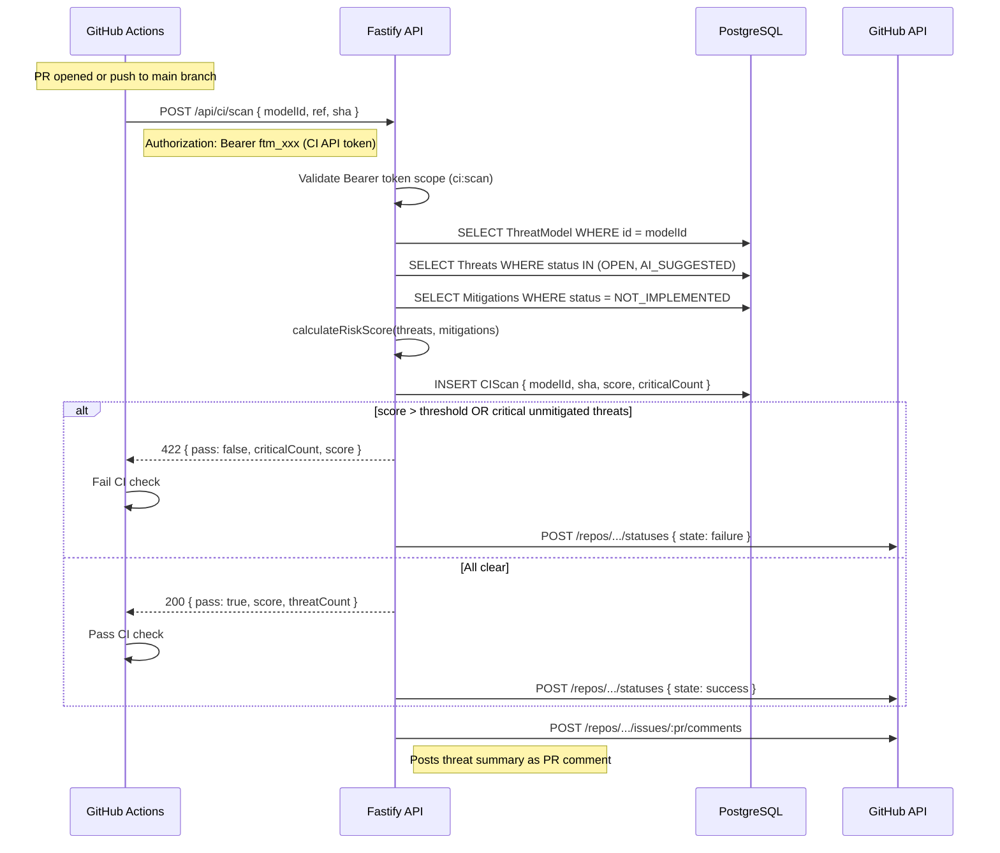
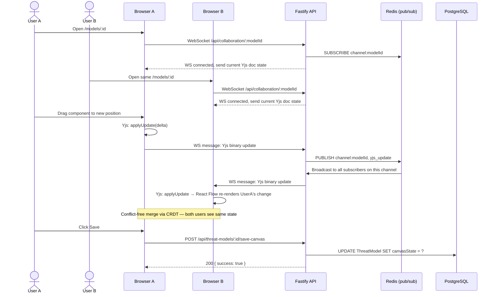

# ThreatForge — API Entry Points

_All major API entry points derived from `server/src/api/` module listing and `docs/sdlc/C4_ARCHITECTURE.md`._

---

## API Surface Overview

The Fastify backend exposes 80+ route modules. Routes are grouped by domain prefix.

### Authentication & User Management

| Method | Path | Description |
|--------|------|-------------|
| POST | `/api/auth-public/verify` | Credential verification (called by Auth.js) |
| POST | `/api/auth-public/register` | New user registration |
| POST | `/api/auth-public/password-reset/request` | Request password reset email |
| POST | `/api/auth-public/password-reset/confirm` | Confirm password reset with token |
| POST | `/api/auth-public/email-verification/verify` | Verify email token |
| POST | `/api/auth-public/email-verification/resend` | Resend verification email |
| GET/PATCH | `/api/users/me` | Get / update own profile |
| POST | `/api/users/me/two-factor/setup` | Begin 2FA enrollment |
| POST | `/api/users/me/two-factor/enable` | Complete 2FA enrollment |
| GET/DELETE | `/api/sessions` | List / revoke active sessions |
| GET/POST/DELETE | `/api/api-tokens` | Manage Bearer API tokens (9 scopes) |

### Organizations & Members

| Method | Path | Description |
|--------|------|-------------|
| GET/POST | `/api/organizations` | List / create organizations |
| GET/PATCH | `/api/organizations/:orgId` | Get / update organization |
| GET/POST | `/api/organizations/:orgId/members` | List / invite members |
| DELETE | `/api/organizations/:orgId/members/:userId` | Remove member |
| POST | `/api/invitations/:token/accept` | Accept org invitation |
| GET/POST/DELETE | `/api/organizations/:orgId/webhooks` | Manage webhooks |
| GET/POST | `/api/organizations/:orgId/custom-roles` | Custom RBAC roles |

### Projects & Threat Models

| Method | Path | Description |
|--------|------|-------------|
| GET/POST | `/api/projects` | List / create projects |
| GET/PATCH/DELETE | `/api/projects/:projectId` | Get / update / delete project |
| GET/POST | `/api/threat-models` | List / create threat models |
| GET/PATCH/DELETE | `/api/threat-models/:id` | Get / update / delete threat model |
| POST | `/api/threat-models/:id/save-canvas` | Persist React Flow canvas state |
| POST | `/api/threat-models/:id/import-documents` | Upload document → AI extraction |
| POST | `/api/threat-models/:id/apply-merge` | Apply AI-extracted merge proposal |
| POST | `/api/threat-models/:id/scan-from-github` | Scan GitHub repo → canvas build |
| POST | `/api/v1/threat-models/:id/save-as-template` | Save model as reusable template |
| POST | `/api/v1/threat-models/from-template/:templateId` | Instantiate model from template |

### Version History

| Method | Path | Description |
|--------|------|-------------|
| GET/POST | `/api/threat-models/:id/versions` | List / create version snapshots |
| POST | `/api/threat-models/:id/versions/:vId/restore` | Restore to a previous version |
| GET | `/api/threat-models/:id/versions/diff` | Diff two versions |

### Threats & Mitigations

| Method | Path | Description |
|--------|------|-------------|
| GET/POST | `/api/threat-models/:modelId/threats` | List / create threats |
| GET/PATCH/DELETE | `/api/threats/:id` | Get / update / delete threat |
| GET/POST | `/api/threats/:threatId/mitigations` | List / create mitigations |
| PATCH/DELETE | `/api/mitigations/:id` | Update / delete mitigation |
| PATCH | `/api/mitigations/:id/evidence` | Update evidence links |
| POST | `/api/bulk` | Bulk operations (accept/assign/delete) |

### AI Features

| Method | Path | Description |
|--------|------|-------------|
| POST | `/api/ai/suggest-threats` | Enqueue SUGGEST_THREATS job |
| POST | `/api/threat-models/:id/ai/expert-analysis` | Enqueue 6-pass expert analysis |
| POST | `/api/threat-models/:id/ai/micro-analysis` | Trigger micro-analysis pipeline |
| POST | `/api/threat-models/:id/ai/agentic-analysis` | Enqueue agentic (tool-use) analysis |
| POST | `/api/threat-models/:id/ai/attack-tree` | Generate attack tree for a threat |
| GET | `/api/ai-jobs/:jobId` | Poll AI job status |
| GET | `/api/ai-jobs` | List AI jobs for a model |
| DELETE | `/api/ai-jobs/:jobId` | Cancel an AI job |
| POST | `/api/ai/chat` | Streaming AI chat assistant |
| POST | `/api/ai/sequence-diagram` | Auto-generate sequence diagram |

### Compliance & Reporting

| Method | Path | Description |
|--------|------|-------------|
| GET | `/api/compliance` | Compliance gap analysis for a model |
| GET | `/api/compliance/:framework/controls/:id` | Drill into a specific control |
| GET | `/api/data-export/risk-register` | Export risk register CSV |
| GET | `/api/reporting/model/:id/pdf` | Generate PDF export payload |
| GET | `/api/risk-overview` | Risk overview for dashboard |

### Admin & System

| Method | Path | Description |
|--------|------|-------------|
| GET | `/api/admin/users` | List all users (super-admin) |
| POST | `/api/setup/initialize` | First-time setup wizard |
| GET | `/health` | Full health check |
| GET | `/health/live` | Kubernetes liveness probe |
| GET | `/health/ready` | Kubernetes readiness probe |
| GET | `/docs` | Swagger OpenAPI documentation |

### Public API v1 (Bearer token)

| Method | Path | Description |
|--------|------|-------------|
| GET/POST | `/api/v1/threat-models` | CRUD via API token |
| GET | `/api/v1/threats` | List threats |
| POST | `/api/ci/scan` | CI/CD threat model scan |
| GET/POST | `/scim/v2/Users` | SCIM 2.0 user provisioning |
| GET/PATCH | `/scim/v2/Users/:id` | SCIM user update / deactivate |

---

## Key Sequence: CI/CD Scan

---

## Key Sequence: Real-Time Collaboration

