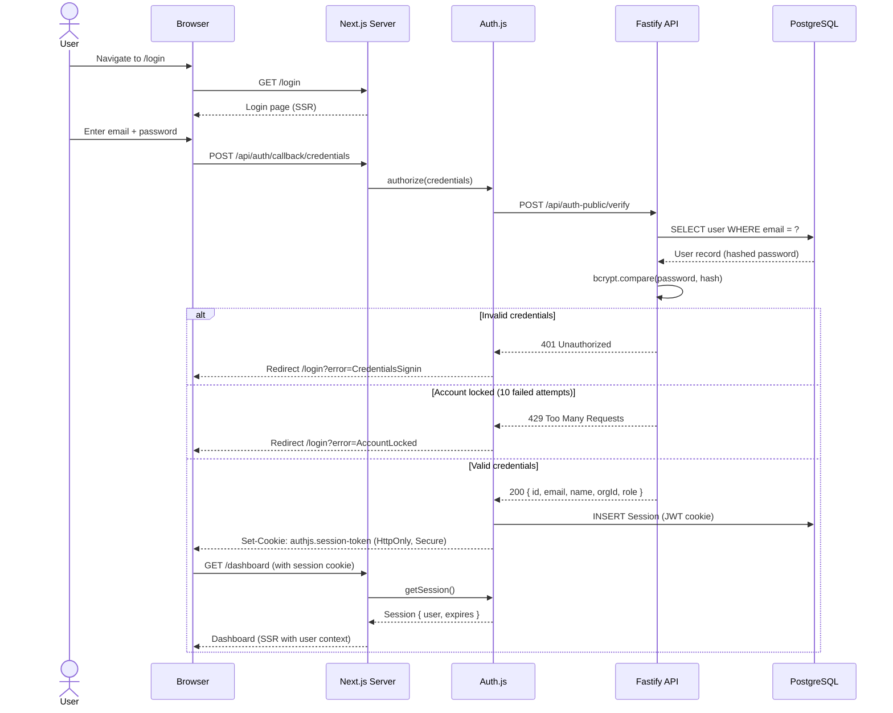
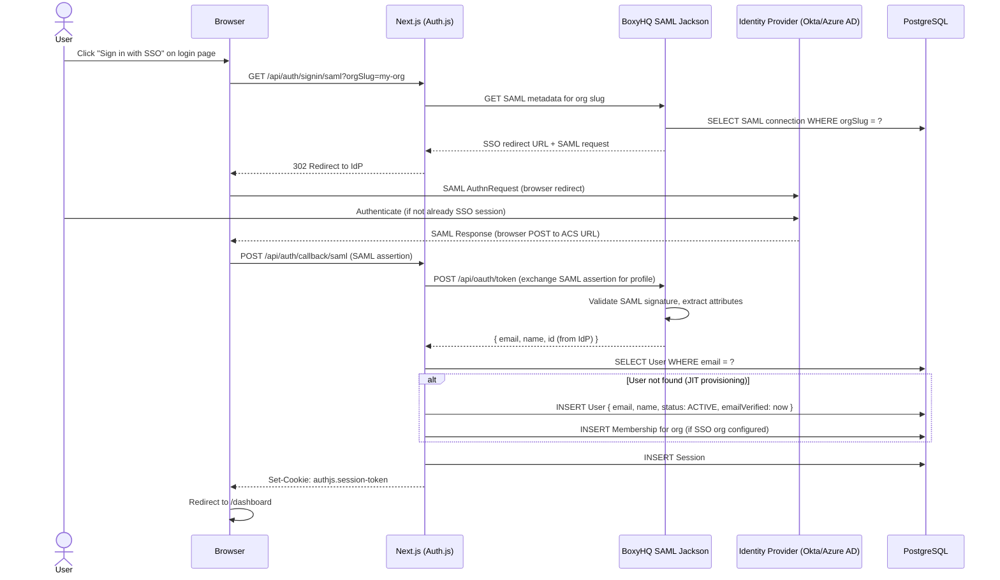
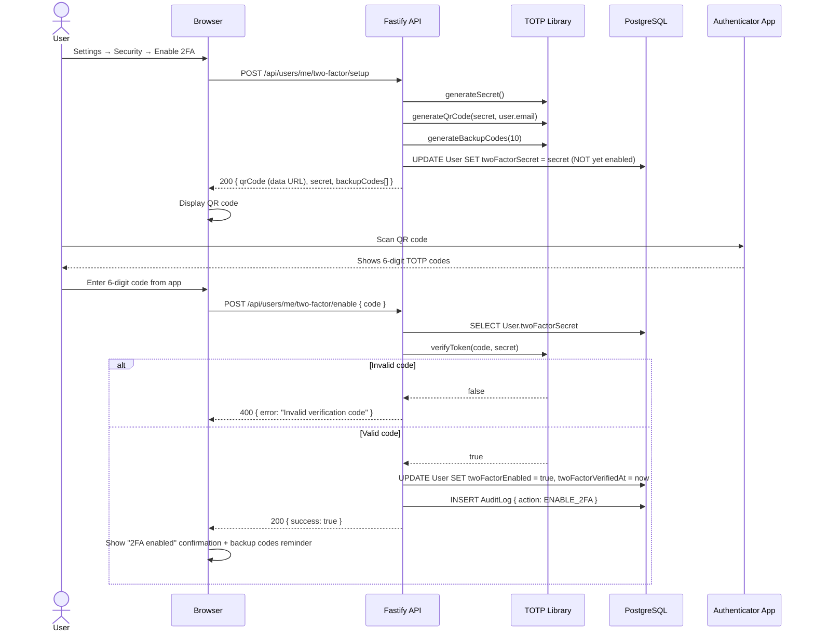
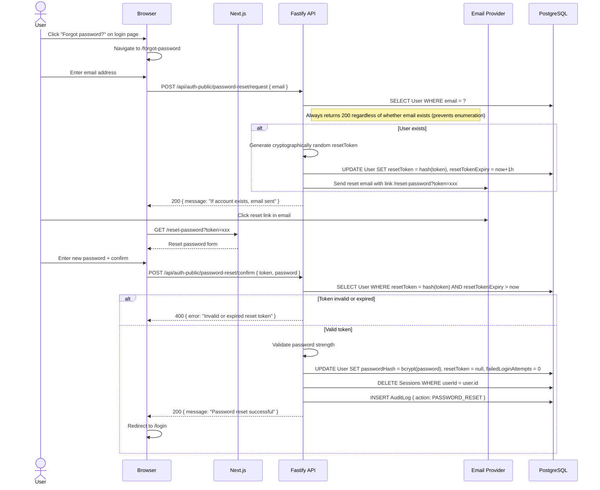
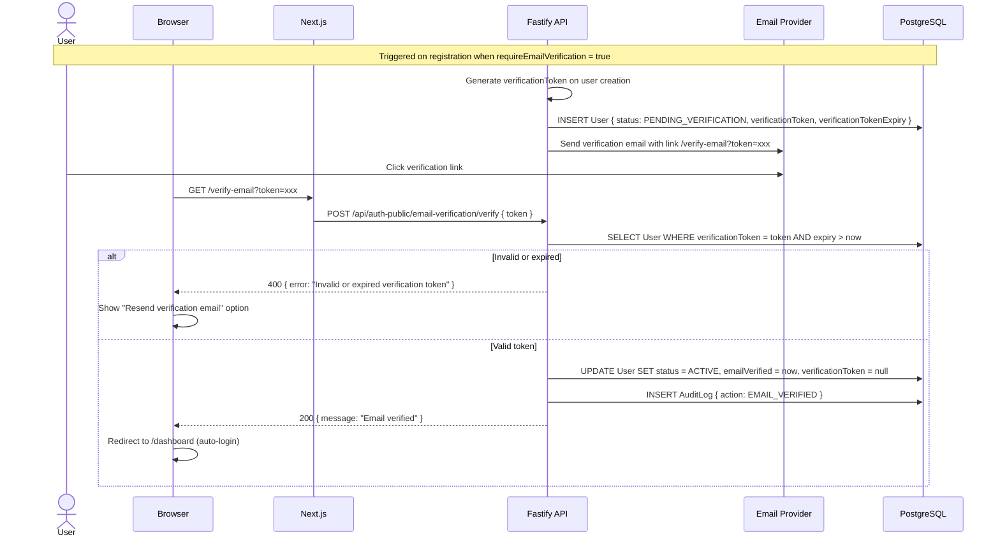
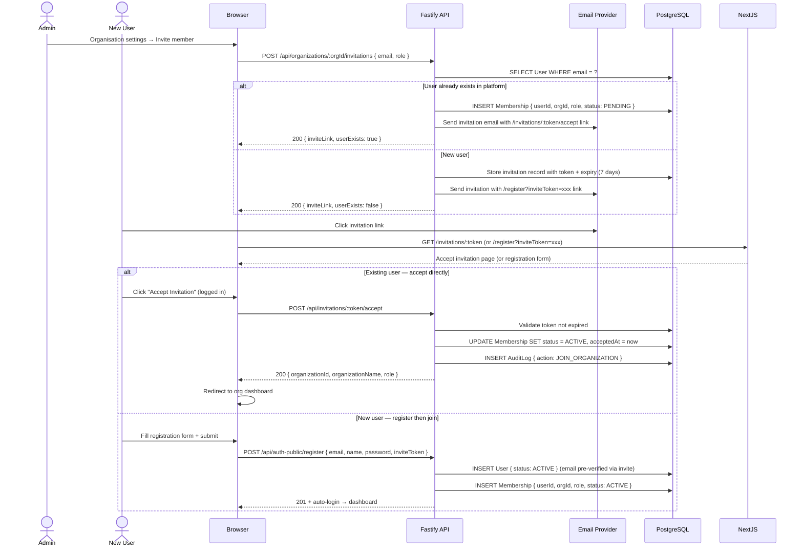

# ThreatForge — Authentication Sequence Diagrams

_Derived from `docs/sdlc/SEQUENCE_DIAGRAMS.md`. Covers credentials login, SSO/SAML, 2FA, password reset, email verification, and invitation accept._

---

## 1. Credentials Login

---

## 2. SSO / SAML Login

---

## 3. Two-Factor Authentication Enrollment

---

## 4. Password Reset

---

## 5. Email Verification

---

## 6. Invitation Accept

