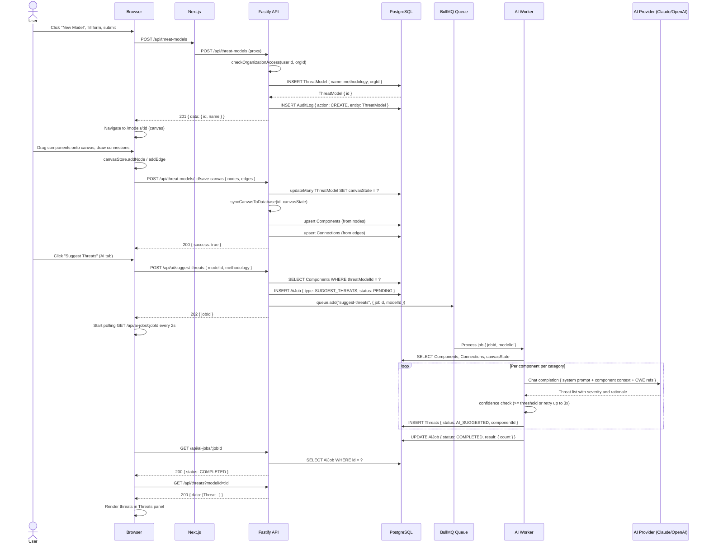
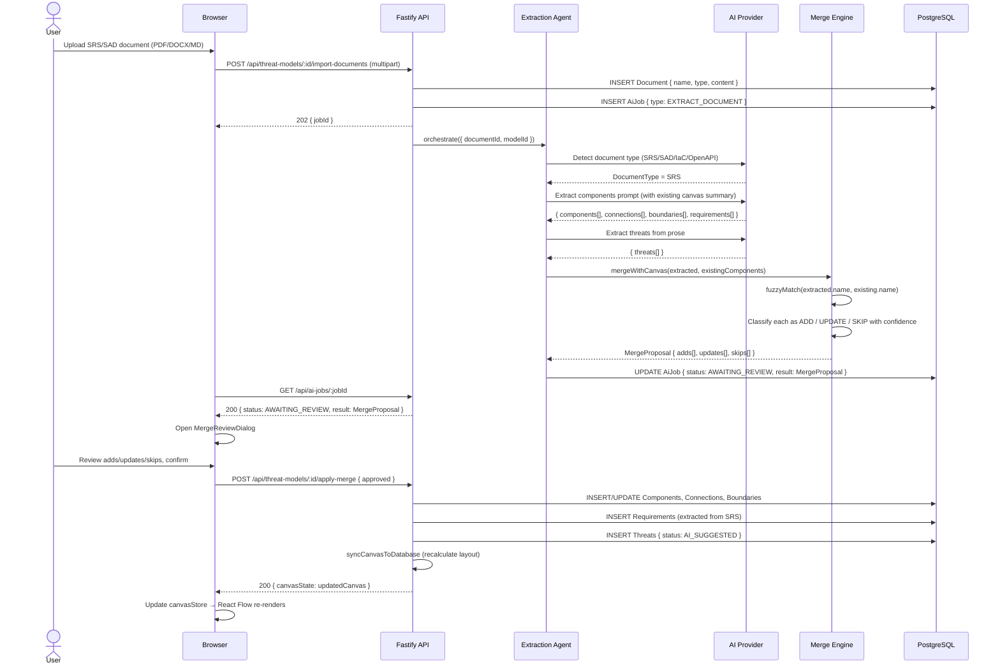
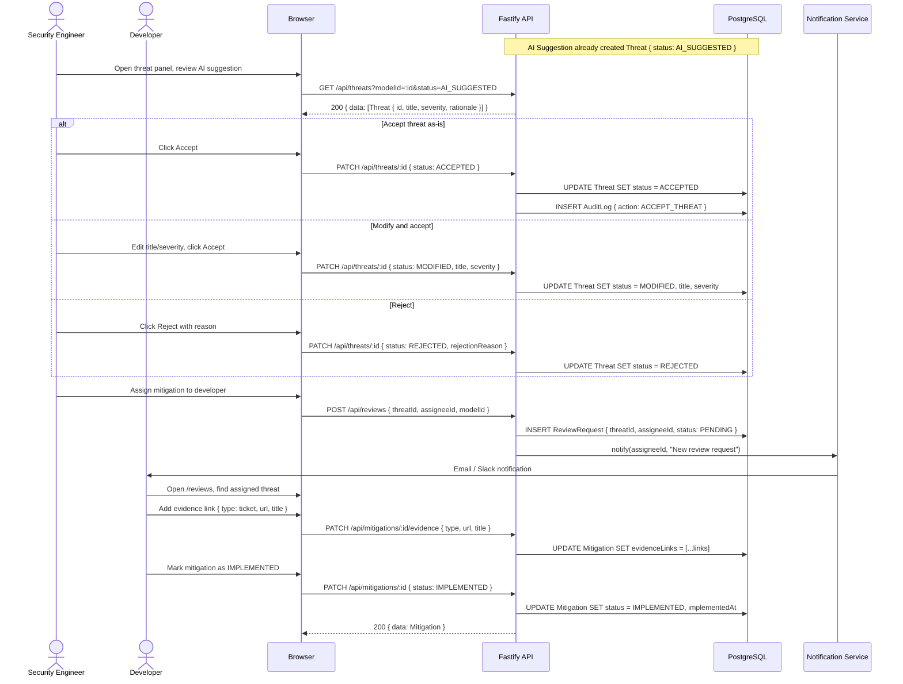
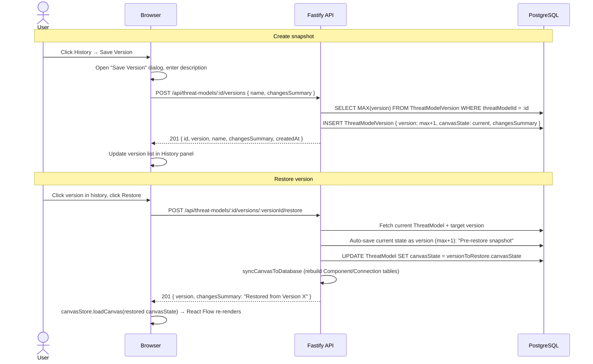
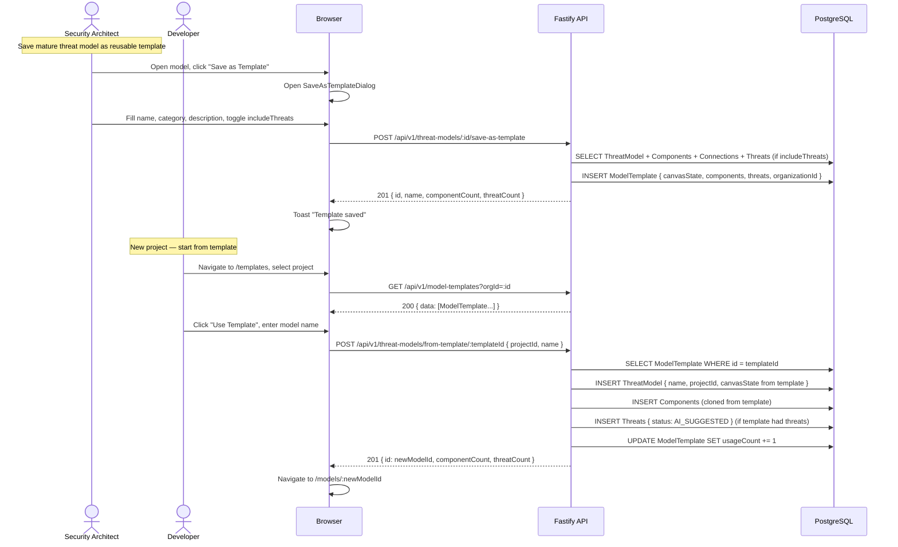

# ThreatForge — Threat Model Creation Sequence Diagrams

_Derived from `docs/sdlc/SEQUENCE_DIAGRAMS.md`. Covers the primary write flows: create model, AI threat suggestion, document import, version history, and template use._

---

## 1. Create Threat Model + AI Threat Suggestion

---

## 2. Document Import → AI Extraction → Canvas Merge

---

## 3. Human-in-the-Loop Threat Review

---

## 4. Version History — Snapshot and Restore

---

## 5. Model Template: Save and Instantiate

